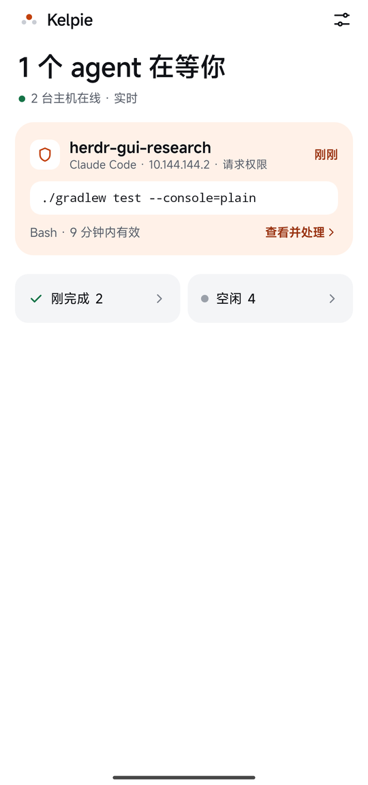
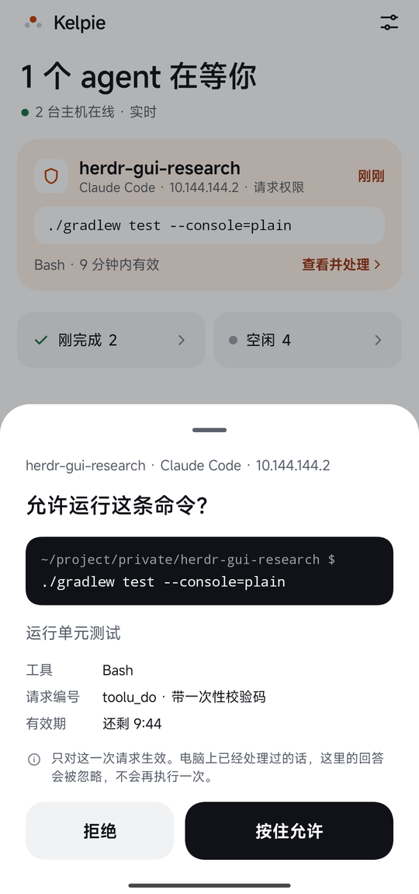
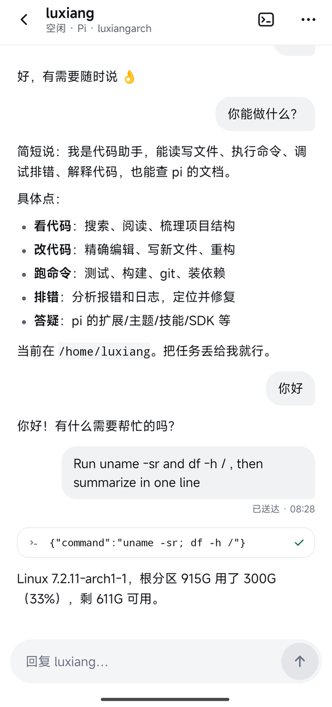
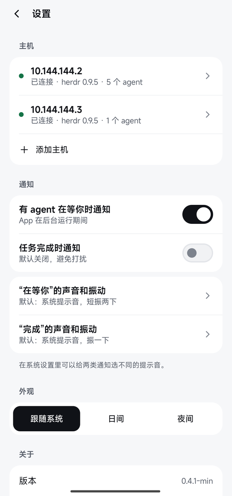
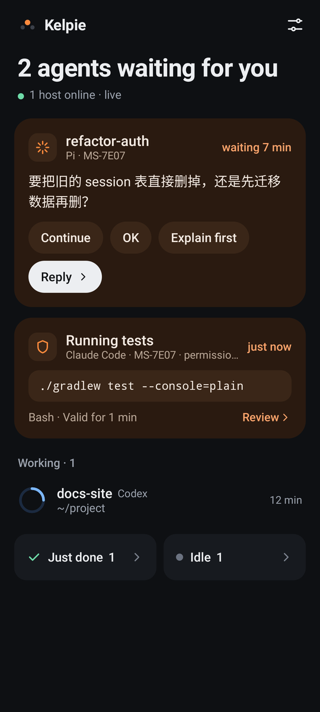

# Kelpie

English | [中文](README.zh-CN.md)


Supervise the coding agents (Claude Code / Codex / Pi) that [herdr](https://herdr.dev) hosts on your remote dev machines, from your phone, once you've stepped away from the computer.
It is **not** a mobile SSH terminal, and it is not an official herdr project.

- **Home**: every agent on every host, sorted by what needs you: waiting on you → working → just finished → idle. Agents that are waiting show what they asked or what they want to run.
- **Conversation**: read Claude Code / Codex / Pi sessions as structured conversations; search inside a conversation, open full tool output, and send follow-up instructions with a delivery receipt.
- **Act from the phone**: start a new Claude Code / Codex / Pi in a directory you pick (optionally with permission prompts skipped), or interrupt a working agent (one Esc, press and hold to confirm).
- **Approvals**: when an agent wants to run a command, press and hold to allow it, or deny it, from the phone (Claude Code / Codex; the hook is in [`companion/`](companion/)).
- **Pairing**: run a script on the dev machine to show a QR code, scan it and the host is added. Host keys are pinned; there is no trust-on-first-use.
- Background notifications (works on MIUI), Chinese and English UI (follows the system, or pick one in Settings), light and dark themes.

<p>





</p>

Current version: **0.6.0**. See [`CHANGELOG.md`](CHANGELOG.md) for release notes.

## Install and use

There is no server component: the phone connects to each dev machine over SSH and calls the API that ships with herdr.

1. **Dev machine**: reachable from the phone over SSH; herdr 0.9.5 (protocol 22) installed, with a session kept running and the agents started inside herdr; herdr's claude / codex / pi integrations installed.
2. **Phone**: install `dist/kelpie-<version>.apk` (Android 8.0+), run the pairing script on the dev machine and scan the QR code to add the host.
3. Optional: install the approval hook so you can approve agent commands on the phone (there is no install script yet).

Step-by-step instructions, a checklist and an FAQ are in [`docs/setup.md`](docs/setup.md) (in Chinese).

## Quick start (development)

You need JDK 17 and the Android SDK (compileSdk 37); put `sdk.dir` in `local.properties`.

```bash
./gradlew :app:assembleDebug     # debug build, package io.github.luxiang0412.kelpie.debug
./gradlew test                   # unit tests
```

Building, testing, releasing and debugging are covered in [`docs/development.md`](docs/development.md) (in Chinese).

## Layout

```text
app/                    # the app: Activity, navigation, screens, notifications, foreground service
core/
  ssh/                  # SSH connections, host key trust
  herdr/                # herdr protocol, connection supervision, Claude / Codex / Pi transcript parsing, UI copy
  data/                 # host config, caches, drafts, approvals; runtime/ (multi-host runtime), attention/ (home ordering)
  designsystem/         # color / type / spacing tokens, icons, base components
  markdown/             # Markdown rendering
benchmark/              # Macrobenchmark (cold start, long-conversation scrolling)
build-logic/            # Gradle convention plugins: Android config shared by all modules
gradle/libs.versions.toml  # dependency and plugin versions
companion/              # scripts for the dev machine: QR pairing, approval hook
docs/                   # documentation (index in docs/README.md)
tools/                  # development scripts
art/                    # logo sources
```

Dependency direction: `app` → `core:markdown` / `core:designsystem` / `core:data` → `core:herdr` → `core:ssh`.

## Documentation

The docs are written in Chinese. Architecture: [`docs/architecture.md`](docs/architecture.md); setup: [`docs/setup.md`](docs/setup.md); index of everything else: [`docs/README.md`](docs/README.md).
