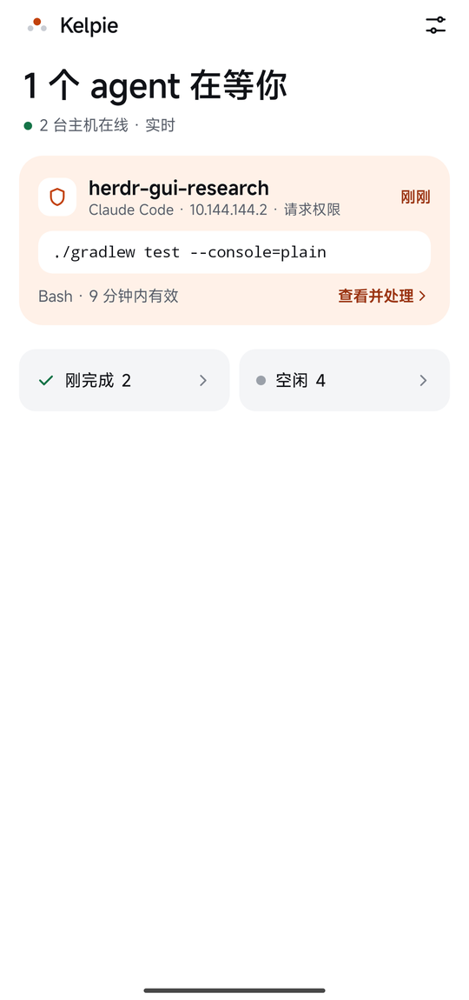
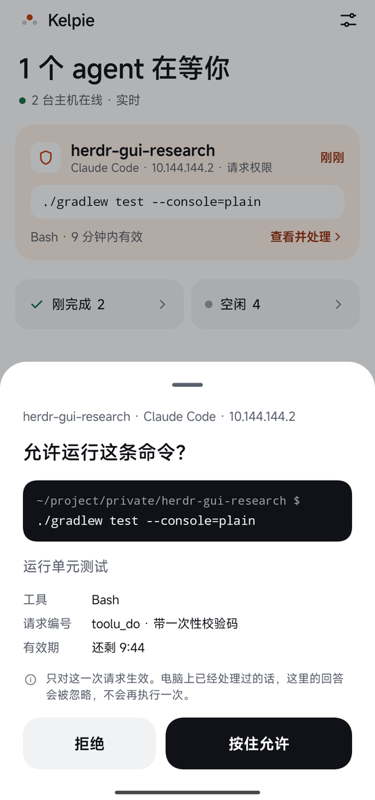
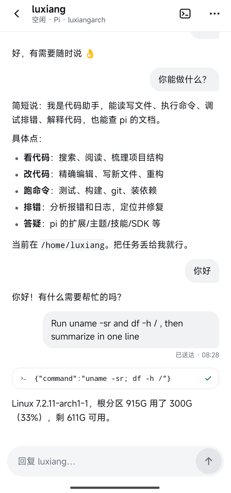
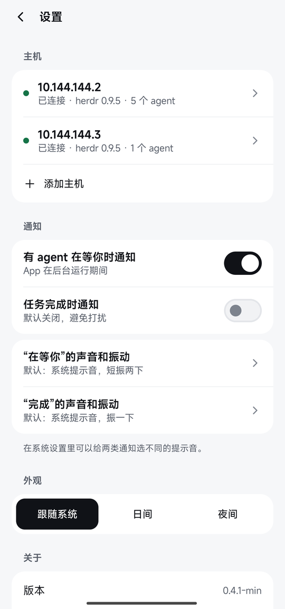
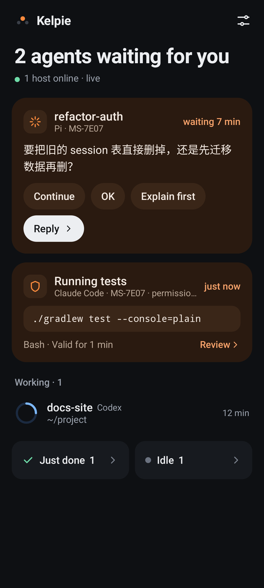

# Kelpie

[English](README.md) | 中文


人离开电脑后，用手机监督远程开发机上由 [herdr](https://herdr.dev) 托管的 coding agent（Claude Code / Codex / Pi）。
**不是**移动 SSH 终端。

- **首页**：所有主机、所有 agent 按注意力排序：在等你 → 工作中 → 刚完成 → 空闲。在等你的直接显示它问了什么、要运行什么。
- **对话**：读 Claude Code / Codex / Pi 的结构化对话；对话内搜索，查看工具完整输出；补发指令，带送达回执。
- **审批**：agent 要运行命令时，在手机上按住允许或拒绝（Claude Code / Codex，hook 见 [`companion/`](companion/)）。
- **配对**：开发机上运行脚本生成二维码，手机扫一下就添加好主机；主机指纹固定，不做首次信任（TOFU）。
- 后台通知（MIUI 可用）、中英文（跟随系统，也可以在设置里固定）、日夜间主题。

<p>





</p>

当前版本 **0.5.1**，更新说明见 [`CHANGELOG.md`](CHANGELOG.md)。

## 安装与使用

没有单独的服务端：手机直接用 SSH 连开发机，调用 herdr 自带的接口。

1. **开发机**：SSH 能从手机连到；装 herdr 0.9.5（协议 22），会话一直开着，agent 在 herdr 里启动；装 herdr 的 claude / codex / pi 集成。
2. **手机**：装 `dist/kelpie-<版本>.apk`（Android 8.0+），在开发机上运行配对脚本，手机扫码添加主机。
3. 可选：装审批 hook，就能在手机上批准 agent 运行命令（目前还没有安装脚本）。

每一步的具体做法、自查清单和常见问题见 [`docs/setup.md`](docs/setup.md)。

## 快速开始（开发）

需要 JDK 17、Android SDK（compileSdk 37），`local.properties` 里写 `sdk.dir`。

```bash
./gradlew :app:assembleDebug     # 调试包，包名 io.github.luxiang0412.kelpie.debug
./gradlew test                   # 单元测试
```

完整的构建、测试、发版、调试说明见 [`docs/development.md`](docs/development.md)。

## 目录结构

```text
app/                    # 应用：Activity、导航、各页面、通知、前台服务
core/
  ssh/                  # SSH 连接、主机指纹信任
  herdr/                # herdr 协议、连接监督、Claude / Codex / Pi 会话解析、中英文案
  data/                 # 主机配置、缓存、草稿、审批；runtime/（多主机运行时）、attention/（首页排序）
  designsystem/         # 颜色 / 字体 / 间距 token、图标、基础组件
  markdown/             # Markdown 渲染
benchmark/              # Macrobenchmark（冷启动、长对话滚动）
build-logic/            # Gradle 约定插件：各模块共用的 Android 配置
gradle/libs.versions.toml  # 依赖和插件版本
companion/              # 装在开发机上的脚本：扫码配对、审批 hook
docs/                   # 文档（索引见 docs/README.md）
tools/                  # 开发脚本
art/                    # 标志源文件
```

依赖方向：`app` → `core:markdown` / `core:designsystem` / `core:data` → `core:herdr` → `core:ssh`。

## 文档

架构见 [`docs/architecture.md`](docs/architecture.md)，安装配置见 [`docs/setup.md`](docs/setup.md)，其余文档的索引见 [`docs/README.md`](docs/README.md)。
