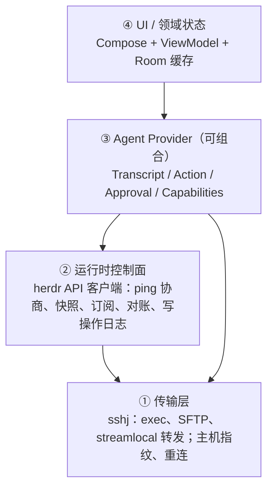
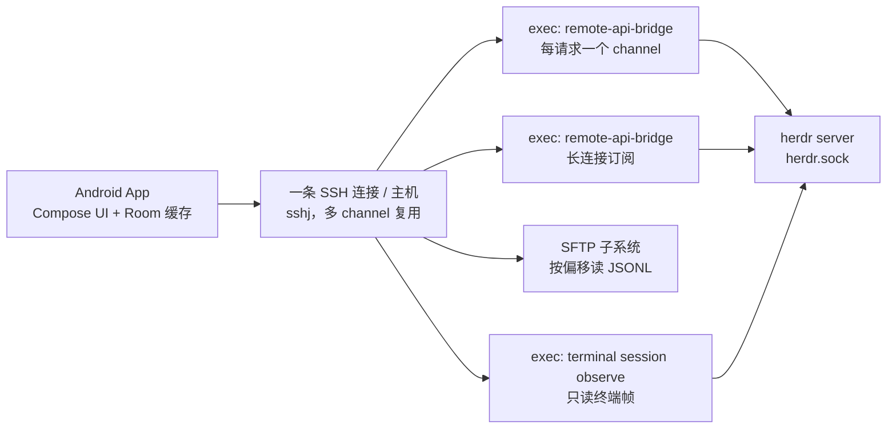

# herdr 原生 Android 客户端调研（v2）

> 定位：一个 **Coding Agent 监督与交互客户端**。herdr 已经提供结构化的 JSON socket 接口和事件流，手机端不用解析终端画面就能拿到状态。v2 合并了 v1 调研和 ChatGPT 的深度技术复核，并对关键结论逐条查了源码和官方文档。查不到或需要实测的地方都标了 **【待验证】**。

| 项目 | 内容 |
| --- | --- |
| 文档版本 | v2.1（v1：2026-10-28；v2：2026-10-29；v2.1：2026-10-29，按 7 项 P0 问题修订） |
| 作者 | v1 由 Grok Bot 调研；ChatGPT 做深度技术复核；v2 由 Grok Bot 合并，并对照源码和文档核实；v2.1 修订 7 项 P0 安全/语义问题 |
| 核实基线 | herdr 0.9.5（master `bc8c289`，2026-10-28）、Claude Code 官方文档（2026-10）、Codex App Server 官方文档、pi-mono 1.4.0、Compose Material3 发布页（2026-10-21） |
| 本地 schema 基线 | herdr **0.9.3**（Windows 主机实测），`protocol = 22`、`schema_version = 1`、102 个方法，导出文件 `spike/results/herdr-api.schema.json`。**0.9.3 ≠ 0.9.5**，凡是只在这一份 schema 上确认的结论都标注了“0.9.3 schema” |
| 配套文件 | `herdr-android-spike-plan.md`：Spike 任务书；`RESULTS.md` / `DECISIONS.md` / `ISSUES.md` / `NEXT-STEPS.md`：Phase 0 执行记录 |
| 标记约定 | ✅ 已核实（附权威来源）；🧪 已实测（附本地证据文件）；❌ 验证失败；【待验证】要靠 Spike 实测或没有找到权威来源 |

> [!NOTE]
> **v2.1 的修订范围**：只修 7 项 P0 问题和被实测推翻的事实性错误，不改产品方向和架构。修订清单见文末 [v2.1 修订说明](#v21-修订说明)，实测证据见 `RESULTS.md`。

## 目录

- [项目背景](#项目背景)
- [核心结论](#核心结论)
- [产品定位与差异化](#产品定位与差异化)
- [herdr 是什么](#herdr-是什么)
- [herdr 的集成接口（已核实）](#herdr-的集成接口已核实)
- [状态同步：快照与事件的一致性](#状态同步快照与事件的一致性)
- [写操作语义：超时不自动重试，而且没有锁](#写操作语义超时不自动重试而且没有锁)
- [身份模型：pane、agent session、runtime 分开](#身份模型paneagent-sessionruntime-分开)
- [推荐架构：四层 + 可组合 Provider](#推荐架构四层--可组合-provider)
- [推荐的数据链路](#推荐的数据链路)
- [SFTP Tailer 契约](#sftp-tailer-契约)
- [SSH 通道预算与 MaxSessions](#ssh-通道预算与-maxsessions)
- [Claude Code 会话定位（已核实）](#claude-code-会话定位已核实)
- [TranscriptEvent：支持更新和分支](#transcriptevent支持更新和分支)
- [审批安全子系统](#审批安全子系统)
- [团队协作：没有 Presence / Lease / Ownership](#团队协作没有-presence--lease--ownership)
- [ACP 与 herdr-acp](#acp-与-herdr-acp)
- [已有的同类客户端（v2 重新评估）](#已有的同类客户端v2-重新评估)
- [原生 Android 技术栈](#原生-android-技术栈)
- [后台与通知：不写服务端就不能承诺](#后台与通知不写服务端就不能承诺)
- [安全](#安全)
- [流畅度：做法与可量化目标](#流畅度做法与可量化目标)
- [关键页面与交互](#关键页面与交互)
- [模块划分](#模块划分)
- [路线图：Phase 0–3](#路线图phase-03)
- [扩展到 Pi 和 Codex](#扩展到-pi-和-codex)
- [许可证注意事项](#许可证注意事项)
- [待验证事项汇总](#待验证事项汇总)
- [v1→v2 变更说明](#v1v2-变更说明)
- [v2.1 修订说明](#v21-修订说明)
- [来源](#来源)

## 项目背景

### 调研缘起（给阅读本文的 AI / 同事）

**1. 起点：想做能赚钱的产品。** 我是前端 / 全栈开发者，目前全职上班，打算业余做一些产品，以后可能转独立开发。一开始我在找“适合业余起步、能赚钱”的方向。调研下来的结论是：给大平台或热门开发工具补体验短板的小而专的工具，最适合一个人用业余时间做，也最容易验证有没有人愿意付钱。

**2. 触发点：看到 yetone 的帖子。** 2026 年 10 月 28 日，avante.nvim 的作者 yetone 在 X 上发帖（[原帖](https://x.com/yetone/status/2115516478254624914)，约 10 万浏览、800+ 赞、640 收藏）。他说自己平时用 Herdr 做 vibe coding，出门时只能在手机上用远程桌面控制家里的电脑，体验很差，于是给 Alma iOS App 加了一个原生的手机端 Herdr 客户端。这个客户端目前只适配 Claude Code，还自带端到端加密中继、局域网自动直连和远程桌面。

**3. 我自己的真实场景。** 我和团队每天都用 `herdr --remote ssh://xxx --session xx` 远程 vibe coding：agent 跑在远程开发机上，我们从各自的电脑连进同一个 herdr 会话。问题是 **一旦离开电脑，工作就停了**。agent 可能跑了几分钟就停下来等确认、等下一步指令，而我不在电脑前，只能干等，或者回来才发现它早就卡住了。

**4. 痛点具体是什么：**
- **手机上操作终端非常痛苦**：用 SSH App 或远程桌面看 herdr 的 TUI，字太小，要不停放大缩小；长输出、diff、Markdown 都很难读。
- **输入不方便**：手机键盘没有 esc、tab、方向键这些终端常用键；几乎没法发图片（比如截图给 agent 看）；语音输入也用不上。
- **看不到全局状态**：同时跑好几个 agent 时，不知道哪个在工作、哪个已经完成、哪个正 **卡着等我处理**，只能一个个点进去看。
- **不够原生**：远程桌面式的方案本质是把桌面缩小到手机上，交互不是为手机设计的，体验断断续续，不流畅。
- **现有方案不满意**：yetone 的客户端在 iOS 上。Android 上已有的几个 herdr 客户端主要是 Flutter / React Native 写的。（v2 补充：这些竞品其实比 v1 描述的成熟得多，详见[竞品章节](#已有的同类客户端v2-重新评估)。）

**5. 所以我想做什么。** 一个 **原生 Android（Kotlin + Jetpack Compose）** 的 herdr 客户端。离开电脑后，打开手机就能接上同一个 herdr 会话，像用聊天 App 一样监督 agent、回答它的问题、继续 vibe coding。核心要求是 **非常流畅、UI/UX 体验很高**。它首先解决我和团队自己的问题；如果体验做得好，也可能成为对外发布甚至收费的产品。

**6. 这份调研要回答的问题：**
- herdr 有没有可供手机端接入的接口？怎样拿到结构化的状态和对话内容，而不是去解析终端画面？
- 服务端需要做什么？（我希望尽量不写服务端，网络连通我自己解决。）
- 原生 Android 用什么技术栈？哪些做法能保证 120Hz 下也流畅？
- 已有哪些同类客户端？差异化机会在哪里？
- 除了 Claude Code，怎么扩展支持 Pi、OpenAI Codex CLI 等其他 agent？

**7. 调研过程（v2 新增）。**
- **v1**（2026-10-28）：Grok Bot 读了 herdr 源码和文档、几个竞品仓库、Pi 和 Codex 的会话格式，给出了集成方式、技术栈和一个 4 周 MVP 计划。
- **ChatGPT 深度复核**：我把 v1 交给 ChatGPT 做技术复核。它指出了一批一致性、安全和产品定位上的问题，比如快照和事件没有原子边界、写操作不能超时重试、审批不能基于过期的屏幕读数、竞品被低估、漏掉了 ACP / herdr-acp。
- **v2**（本文，2026-10-29）：合并两边的结论，对能核实的点逐条查了源码和官方文档，直接改正文，并在末尾附上变更说明。下一步按配套的 Spike 任务书实测。

### 要点速览

- **我是谁**：前端 / 全栈开发者，目前全职，业余做产品，以后可能独立开发。
- **现状**：团队用 `herdr --remote ssh://xxx --session xx` 远程 vibe coding，主要用 Claude Code，也关注 Pi、OpenAI Codex CLI。
- **痛点**：一离开电脑就没法继续；手机上操作终端体验很差；看不出哪个 agent 在等我。
- **灵感来源**：yetone 在 Alma iOS App 里做的 Herdr 客户端（按状态分组的会话总览 Needs You / Working / Done / Idle、聊天式会话、esc/tab/方向键辅助栏、语音和图片输入、远程桌面模式）。
- **目标**：原生 Android（Kotlin + Compose）的 Coding Agent 监督与交互客户端，非常流畅、UI/UX 高。
- **约束**：网络我自己解决（不需要中继）；尽量不写服务端（可以接受在主机上装 herdr 集成或 hook 这类轻量配置）；先支持 Claude Code，之后扩展 Pi、Codex。
- **本文用途**：技术调研底稿，供交叉验证，也是 Spike 的输入。

## 核心结论

> [!IMPORTANT]
> **1. 控制面用 herdr JSON API，内容面用 agent 自己的结构化数据，终端只做兜底。**
> herdr 的 socket API（NDJSON）提供 `session.snapshot`、`events.subscribe`、`agent.prompt`、`pane.send_keys`、`pane.read` 等方法（✅ 源码 + 文档）。手机通过 SSH exec 运行 `herdr --session xx remote-api-bridge`，就能把 SSH 的 stdin/stdout 接到 API socket 上（✅ `src/remote.rs`）。聊天内容来自 Claude Code 的会话 JSONL；按 Anthropic 官方文档，这个格式是**内部格式、每个版本都可能变**（✅），所以解析层必须做薄，并且能替换。
>
> **能力协商的正确做法（v2.1 修正）**：`ping` 返回的 `capabilities` 是**固定的一组客户端特性开关**（0.9.3 schema：`detached_server_daemon` / `endpoint_protocol_generation` / `health_check` / `live_handoff` / `ssh_agent_registration` / `surface_interest`，🧪），**不是方法清单**。方法是否可用只能由“客户端内置的版本→方法表 + `herdr api schema --json` 导出的 schema”判断，调用不支持的方法按普通错误降级。

> [!IMPORTANT]
> **2. 事件只是失效信号，不能当增量补丁叠到快照上。**
> herdr 官方文档明确写着：快照和事件之间没有共享的序列边界，事件只能触发一次重新读取；收到 `events_lost` 要重新订阅、重新拉快照（✅ socket-api 文档）。

> [!IMPORTANT]
> **3. 审批是最高风险的功能，要单独做成安全子系统。**
> `pane.read` 会返回 `revision`，但 `pane.send_keys` 不接受任何前置条件（✅ 源码 `PaneSendKeysParams` 只有 `pane_id` 和 `keys`，🧪 0.9.3 schema 同）。所以按屏幕读数发按键，永远存在一个**无法消除的 TOCTOU 窗口**：读屏 → 用户思考 → 二次校验 → 发送，这段时间里问题可能已经换了。二次读取只能把窗口从“秒级”缩到“一次 RTT + 服务端排队”，**不能宣称“绝对安全”或“0 次答错”**。优先走结构化审批：Claude Code 的 `PermissionRequest` hook（✅ 官方文档）、herdr-acp、Codex app-server 的 `requestApproval`；读屏只当兜底，并把残余风险写进 UI 和文案。

> [!WARNING]
> **4. 没有服务端，就不能承诺后台通知。**
> Android 15 起，`dataSync` 前台服务每 24 小时最多运行 6 小时（✅ Android 文档）；Android 16 起，前台服务里启动的后台任务也要受配额限制（✅）。可以做“App 在前台时实时 + 离开后短时保活 + 用户手动开启的前台服务”，但不能宣传“像微信一样随时推送”。

> [!WARNING]
> **5. 市场不空，而且竞品比 v1 写的更强。**
> tuan3w 的 herdr mobile 已经有 Needs You 看板、发送前重新读一遍问题、风险选项要长按、ACP 会话、SFTP 文件浏览、可选的本地通知（✅ 仓库 README）。**只靠“原生 Kotlin”不构成差异化**，差异化要落在可验证的体验指标、审批可信度和团队场景上。

> [!CAUTION]
> **6. 所有写操作都没有前置条件、没有幂等键、没有锁（v2.1 新增）。**
> `agent.prompt` / `pane.send_keys` / `pane.send_text` 的 schema 里既没有 `if_revision` / `if_status`，也没有请求 id 或幂等键（🧪 0.9.3 schema）。`agent.wait` **不是锁**：它只是“等到状态变成 X 或超时”，不排斥其他写者。所以“至少一次且不重复”在 herdr 原生 API 上做不到，只能“至多一次 + 未知状态”。

## 产品定位与差异化

**定位：Coding Agent 监督与交互客户端**，不是“手机上的终端”。主要任务按频率排：

1. 看一眼：哪些 agent 在等我、等了多久、在等什么（看板）
2. 安全地回答：批准 / 拒绝 / 选择，确认自己答的就是看到的那个问题（审批）
3. 读懂进展：结构化的对话、命令、diff（会话视图）
4. 补一句指令：文字、语音、图片（输入）
5. 少数情况下接管终端（兜底）

**可能的差异化方向**（都要靠 Spike 和用户试用来验证，目前都是【待验证】的假设）：

| 方向 | 说明 | 竞品现状 |
| --- | --- | --- |
| 审批可信度 | 结构化审批优先；读屏兜底时做 revision 校验 + 二次读取 + 防误触；完整的审批记录 | herdr mobile 已经做了“发送前重新读一遍”和“刚出现的选项忽略点击”，门槛不低 |
| 团队场景（v2.1 降级） | ~~多人连同一个 herdr 会话：谁在处理哪个 agent、避免两人同时回答~~ **Herdr 无 presence/lease/ownership 原语，必须自建协调层（≈写服务端），当前不做** | 没看到竞品专门针对团队做；详见[团队协作](#团队协作没有-presence--lease--ownership) |
| 可量化的流畅度 | 公开 Macrobenchmark 数据：首帧、滚动掉帧率、键盘动画 | herdr mobile 声称键盘弹出零掉帧，要实测对比 |
| 阅读体验 | diff 审阅、长输出折叠、代码高亮、平板 / 折叠屏双栏 | diff 和平板支持普遍偏弱（v1 观察，v2 未逐个复核） |
| 闭源 / 商业化可行性 | 主要竞品是 GPL / AGPL，不能直接复用代码，见[许可证](#许可证注意事项) | — |

## herdr 是什么

| 项目 | 内容 |
| --- | --- |
| 定位 | 给 AI 编程 agent 用的终端多路复用器和运行时，类似 tmux，但能识别 agent 状态 |
| 仓库 | github.com/herdrdev/herdr，Apache-2.0（✅ LICENSE） |
| 实现 | 单个 Rust 二进制；后台 server 持有所有 PTY，客户端断开后 agent 继续跑 |
| 版本 | 0.9.5（✅ `Cargo.toml`）；socket 协议号 `PROTOCOL_VERSION = 22`（✅ `src/protocol/wire.rs`） |
| 层级 | workspace（界面里叫 Space）→ tab → pane；pane 里跑着被识别出的 agent |
| agent 状态 | `idle`、`working`、`blocked`（在等你批准或回答）、`done`、`unknown` |
| 状态来源 | 多数 agent 靠读屏规则（detection manifest）判断；Pi、OMP、Kimi、OpenCode、Kilo、MastraCode 的集成会直接上报状态（✅ Integrations 文档）。**Claude Code 的状态来自读屏**（✅） |

`--remote ssh://…` 的原理：远端 server 持有全部 pane，通过 SSH 把终端内容和会话状态发回本机，界面由本机的 herdr 绘制。客户端和服务端版本不用完全一致，连接时会协商编解码，服务端会通告自己支持的 API 方法和可选能力（✅ socket-api “Protocol stability”）。每个命名会话有独立的 socket：`~/.config/herdr/sessions/<name>/herdr.sock`（✅）。

## herdr 的集成接口（已核实）

| 接口 | 能拿到什么 | 公开程度 | 手机端用途 |
| --- | --- | --- | --- |
| socket API（NDJSON） | workspace / tab / pane / agent 的增删改查、`session.snapshot`、`pane.send_keys`、`agent.prompt`、`pane.read`、`agent.wait` 等 | 公开；`herdr api schema --json` 可以导出 JSON Schema（✅） | 控制面主力 |
| `ping` | 返回 `version`、`protocol`、`capabilities`（✅ `src/api/server.rs`；🧪 0.9.3 实测 `capabilities` 是 6 个 boolean 特性开关，**不包含方法列表**） | 公开 | **能力协商**的入口（版本 + 协议号 + 特性开关） |
| `events.subscribe` | `pane.agent_status_changed`、`pane.created/closed/updated/exited`、`pane.output_changed`（带 `revision`）、`workspace.*`、`tab.*`、`layout.updated` 等（✅） | 公开 | 失效信号 |
| `remote-api-bridge` | 把 SSH 的 stdin/stdout 接到 API socket；`--check` 输出 `herdr-api-bridge-v1`（✅） | **隐藏子命令**，不保证稳定 | 手机端接入 API 的通道 |
| `terminal session observe <pane>` | 只读的 NDJSON 终端帧（base64 编码的 ANSI 字节），可以多个观察者同时看（✅ persistence-remote 文档） | 公开 | 只读终端预览（v2 新增） |
| `terminal session control <pane> --takeover` | 可写控制端：输入、resize、滚动、鼠标；**同一时间只有一个控制端**（✅） | 公开 | 接管终端（会抢走控制权，要在 UI 上明确提示） |
| `pane.read` | `visible` / `recent` / `recent_unwrapped` / `detection` 四种来源的文本，带 `revision`（✅ `PaneReadResult`；🧪 0.9.3 schema 枚举值为下划线写法） | 公开 | 读屏兜底、审批校验 |
| Claude Code JSONL | 结构化消息：文本、thinking、tool_use、tool_result | **官方明确说是内部格式**（✅ Claude 文档） | 聊天视图的数据源 |

几个 v2 新确认的细节：

- **一个连接只处理一个请求**：`handle_connection_with_stop` 只调用一次 `read_initial_request_line`，处理完就关闭；只有订阅连接会保持（✅ `src/api/server.rs`）。`remote-api-bridge` 每次启动只连一次 socket（✅ `src/remote.rs`），所以**每个请求要开一个 exec channel**，这会受到 sshd `MaxSessions` 的限制，见[通道预算](#ssh-通道预算与-maxsessions)。
- **`agent.prompt`**：如果目标 agent 已经是 `blocked`，会直接返回 `agent_blocked` 错误，不发送输入（✅ 文档）。它还接受可选的 `wait` 参数，把“发送”和“等待状态”放进同一个请求，避免竞态（✅）。
- **`agent_session`**：`pane.get/list`、`agent.get/list` 在有记录时会返回 `{source, agent, kind, value}`，`kind` 是 `id` 或 `path`（✅）。另外还有 `foreground_cwd` 字段，表示当前前台进程的 cwd（✅），算 Claude 日志路径时要优先用它，而不是 pane 的 `cwd`。
- **未知字段与未知方法**：官方要求 JSON API 客户端忽略未知字段，把不支持的方法当普通错误处理（✅）。
- **能力协商只能靠 schema，不能靠 `ping`（v2.1 修正，🧪）**：`ping` 的 `capabilities` 是特性开关（见上表），方法是否可用要看本地内置的 `version → method set` 表，或者干脆尝试调用并把错误当降级信号。错误码在 schema 里是自由字符串（`ErrorBody.code: string`），`events_lost`、`agent_blocked` 这些**不在 schema 里枚举**，客户端必须按字符串处理并保留未知错误码。
- **路径因平台而异**：Linux/macOS 是 `~/.config/herdr/sessions/<name>/herdr.sock`；Windows 是 `%APPDATA%\herdr\sessions\<name>\herdr.sock`（🧪 本机实测 `herdr status` 输出），不要硬编码 `~/.config`。

## 状态同步：快照与事件的一致性

v1 写的是“先订阅，再快照，然后用事件更新”。这个方向对，但**不能把事件载荷直接叠到快照上**。官方文档原文要点（✅ socket-api “Event subscriptions”）：

- 订阅从请求被接受时才开始，**不重放**之前的事件；
- 事件历史不持久；订阅者落后时，服务器发送 `events_lost` 并**关闭这个订阅连接**；
- 快照和事件**没有共享的序列边界**，只保证同一个订阅条目内部有序；
- 恢复步骤：开新订阅，等 `subscription_started`，持续读取的同时在另一条连接上请求 `session.snapshot`；用快照整体替换缓存，之后收到的事件只当失效信号，触发再读一次；**刷新要串行**，刷新期间又来了事件，就完成后再刷一次。
- 订阅里引用了不存在的 pane，整个订阅请求会被拒绝并断开连接（✅ 文档；具体报错形式【待验证】）。

**订阅粒度（🧪 0.9.3 schema 已核实，v2.1 修正）**：

| 订阅条目 | 必填字段 | 说明 |
| --- | --- | --- |
| `pane.agent_status_changed` | `type` + **`pane_id`** | **逐 pane 订阅**。不带 `pane_id` 的请求不合法 |
| `pane.output_matched` | `type` + `pane_id` + `source` + `match` | 也是逐 pane，还需要指定输出源和匹配规则 |
| `pane.created` / `pane.closed` / `pane.updated` / `pane.exited` / `pane.agent_detected` / `pane.focused` / `pane.moved` | 仅 `type` | 全局事件，**不能再带 `pane_id`** |
| `tab.*` / `workspace.*` / `worktree.*` / `layout.updated` | 仅 `type` | 全局事件 |

这意味着客户端要维护**两层订阅**：全局生命周期事件 + 逐 pane 的 `agent_status_changed`；收到 `pane.created` 后必须为**新 pane 补一条状态订阅**，收到 `pane.closed` 后退订。v2 的示例把 `pane.agent_status_changed` 当成全局事件写，是错的，Spike 2 任务书已同步修正。

客户端实现（伪代码）：

```kotlin
// 单线程 actor：所有刷新串行执行
class Reconciler(private val api: HerdrApi) {
    private var dirty = false
    private var refreshing = false

    suspend fun onEvent(e: HerdrEvent) {          // 事件只标记失效
        dirty = true
        if (!refreshing) drain()
    }

    private suspend fun drain() {
        refreshing = true
        while (dirty) {
            dirty = false
            val snap = api.sessionSnapshot()      // 权威读取，每次都是新连接
            cache.replaceAll(snap)                // 整体替换，不做 patch
        }
        refreshing = false
    }

    suspend fun onEventsLost() {                  // 重订阅 + 全量对账
        cache.markStale()
        subscription.restart(awaitStarted = true)
        dirty = true; drain()
    }
}
```

优化（Phase 1 之后再做）：对 `pane.agent_status_changed` 这类高频事件，可以只重新读取受影响的那个 pane（`pane.get`），不用每次拉全量快照。但这是“定向权威读取”，仍然不是 patch。

## 写操作语义：超时不自动重试，而且没有锁

`agent.prompt`、`pane.send_keys`、`pane.send_text` 都是“发出去就不管”的写操作：**超时后不知道到底有没有生效**。网络层自动重试可能导致消息发两遍，或者同一个按键按两次（比如第二次 Enter 批准了下一个问题）。

**schema 已核实（🧪 0.9.3）**：这三个方法的参数里没有任何前置条件、请求 id 或幂等键——

| 方法 | 参数 | 服务端侧前置条件 | 幂等键 | 结果可观测性 |
| --- | --- | --- | --- | --- |
| `agent.prompt` | `target`, `text`, `wait?` | 无（agent 处于 `blocked` 时返回 `agent_blocked`，这是唯一的拒绝路径） | 无 | 中：能在 transcript 里找这段文本，但 JSONL 异步落盘有延迟，可能误判 |
| `pane.send_keys` | `pane_id`, `keys` | 无 | 无 | 低：按键没有回显，基本不可观测 |
| `pane.send_text` | `pane_id`, `text` | 无 | 无 | 中：`pane.read --source visible` 能看到回显（前提是 pane 在 `cat` 之类会回显的状态） |
| `pane.send_input` | 参见 schema | 无 | 无 | 低 |

### `agent.wait` 不是互斥锁（P0 修正）

`agent.wait` 的参数只有 `target` / `timeout_ms` / `until`，语义是“阻塞等到 agent 进入某个状态，或者超时返回”（🧪 0.9.3 schema）。它：

- 不持有任何资源，也不排斥其他写者；等待期间电脑端 TUI、另一台手机、herdr-acp 都可以写同一个 pane；
- 不提供“读—改—写”的原子性：`agent.wait` 返回后到真正发送之间，状态仍可能变；
- 不提供 ownership 信息，也不阻止别人接管。

所以 v2 中“`agent.wait` 会锁定 pane 当前的占用者”的说法**是错的，v2.1 已删除**。写互斥只能在客户端做**advisory（提示性）**的尽力而为：同一个 App 实例内用 per-pane 的协程 Mutex 串行化自己的写操作，并把“别人可能同时在写”作为常态告知用户。跨客户端互斥不成立（详见[团队协作](#团队协作没有-presence--lease--ownership)）。

### 两条写路径

1. **结构化请求带请求 id**（L1 审批 / ACP / Codex app-server）——对端按 id 去重，重发是安全的；
2. **herdr 原生写方法**（没有 id）——永远做不到“至少一次且不重复”，只能“至多一次 + 未知状态”。

| 情况 | 处理 |
| --- | --- |
| 读操作超时 | 可以带退避自动重试 |
| 写操作明确失败（收到 error 响应） | 显示错误，由用户决定是否重发 |
| 写操作超时 / 连接中断 / channel 被关 | 标记 **`Unknown`**，**不自动重试**；先做权威读取，再给用户“重发”按钮 |
| 审批类写操作超时 | 一律不重试；重新进入审批流程，从头校验 |

### `Unknown` 的处置规则（P0 补充）

- `Unknown` **永远不会被自动升级成** `Accepted`。只有权威读取拿到正向证据才算送达，否则一直显示“状态未知”，直到用户处理。
- 权威读取按方法选：`agent.prompt` → 重新拉 `session.snapshot` + 读 transcript 尾部若干行按文本哈希找；`pane.send_text` → `pane.read --source visible` 找回显；`pane.send_keys` → 基本无法判定，只能看状态有没有离开 `blocked`，判不出来就如实显示“未确认”。
- 权威读取本身也会失败（断网、文件落盘延迟），所以 UI 必须能停在“仍未确认”，**不能编一个结果**。
- 同一个 `clientRequestId` 只允许真正发送一次；重发必须用新 id，并在日志里记为两次独立尝试（审计可见）。
- 自动重连（sshj 指数退避）与写操作重试是两回事：重连只重建通道、重新对账，**绝不重放队列里的写请求**。

herdr 的成功响应只表示“输入已进入队列”，不表示已经执行（✅ 文档对 `pane.send_input` 的说明）。每个写操作都要在本地记录 `{clientRequestId, method, target, payloadHash, sentAt, outcome, attempts, evidenceRef}`，方便排查和做 UI 状态。

## 身份模型：pane、agent session、runtime 分开

v1 默认“一个 pane = 一个 agent = 一个会话”，这不成立：

| 身份 | 例子 | 会变吗 | 用来做什么 |
| --- | --- | --- | --- |
| **Pane 身份** | `w1:p2`（public pane id） | pane 被移动时会变（herdr-acp 文档提到 `herdr pane move` 后要跟踪新 id）；关闭后会不会被复用【待验证】 | 发输入、读屏的目标 |
| **Agent session 身份** | Claude 的 sessionId、Pi 的会话文件路径、Codex 的 thread id；来自 `agent_session` | `/clear`、`/compact`、`--resume`、fork 时可能换（herdr 的 Claude 集成会在 `SessionStart` 的 startup/resume/clear/compact/fork 时重新上报，✅ Integrations 文档） | transcript 定位、本地缓存的主键 |
| **Runtime 身份** | pane 里当前的进程（`pane.process_info`）、ACP 会话、Codex app-server 连接 | 进程重启就变 | 判断 agent 是否还是同一个“占用者” |

规则：UI 卡片用 `(hostId, herdrSession, paneId)` 定位，但**聊天记录挂在 agent session 上**。每次对 pane 写入前，先做一次权威读取（`pane.get` / `pane.read`）确认当前占用者没变，变了就丢弃待发内容——但这只是减小风险，**不是锁**（见[`agent.wait` 不是互斥锁](#agentwait-不是互斥锁p0-修正)）。不确定时先刷新，不要发。

## 推荐架构：四层 + 可组合 Provider

v1 的单一 `AgentAdapter` 接口，把“读对话”“发输入”“审批”“能力”捆在了一起。实际情况是每种 agent、每种接入方式能力都不一样。比如 Claude 通过 JSONL 能读对话，但审批只能读屏或靠 hook；接入 app-server 的 Codex 什么都能结构化。v2 改成四层，第三层由多个小 Provider 组合：



```kotlin
interface AgentCapabilitiesProvider {               // 这个 agent + 这台主机能做什么
    suspend fun capabilities(agent: AgentRef): AgentCapabilities
}
interface AgentTranscriptProvider {                 // 读对话（JSONL / ACP / app-server）
    fun canHandle(agent: AgentRef, caps: AgentCapabilities): Boolean
    fun transcript(session: AgentSessionRef): Flow<TranscriptEvent>
}
interface AgentActionProvider {                     // 发消息、辅助键、中断
    suspend fun prompt(target: PaneRef, input: UserInput): WriteOutcome
    suspend fun keys(target: PaneRef, keys: List<String>): WriteOutcome
}
interface ApprovalProvider {                        // 审批：结构化优先，读屏兜底
    fun pending(agent: AgentRef): Flow<ApprovalRequest?>
    suspend fun answer(req: ApprovalRequest, choice: ApprovalChoice): WriteOutcome
}

data class AgentCapabilities(
    val structuredTranscript: Boolean,
    val structuredApproval: Boolean,     // hook / ACP / app-server
    val tokenStreaming: Boolean,
    val imageInput: Boolean,
    val herdrMethods: Set<String>,       // 来自 ping / schema
)

sealed interface WriteOutcome {
    data object Accepted : WriteOutcome
    data class Rejected(val code: String, val message: String) : WriteOutcome
    data object Unknown : WriteOutcome   // 超时 / 断线：不自动重试
}
```

组合示例：

| Agent / 接入方式 | Transcript | Action | Approval |
| --- | --- | --- | --- |
| Claude Code（herdr pane，默认） | Claude JSONL（SFTP 读取） | herdr `agent.prompt` / `send_keys` | 读屏兜底（Phase 2）→ `PermissionRequest` hook（Phase 3） |
| Claude Code（经 herdr-acp） | ACP `session/update` | ACP `session/prompt` | ACP `session/request_permission` |
| Pi（herdr pane） | Pi JSONL（herdr 上报路径） | herdr | 扩展事件 + 读屏 |
| Codex（app-server 模式） | app-server `item/*` | `turn/start` / `turn/steer` | `item/*/requestApproval` |
| 任何 agent，没有适配 | 无（显示终端预览） | herdr | 只读提示，引导用户接管终端 |

## 推荐的数据链路



1. **连接与协商**：建 SSH 连接——首次连接只做 KEX、拿到 host key、展示指纹、**等用户显式确认后才发送任何凭据**（禁止 TOFU，见[安全](#安全)）→ `remote-api-bridge --check` → `ping`，记录 `version / protocol / capabilities`；方法可用性以 schema 为准，不支持的方法当普通错误降级。
2. **冷启动**：先开订阅 channel，等 `subscription_started`，再在另一个 channel 调 `session.snapshot`，用快照整体建缓存。UI 先显示 Room 里的旧数据，并标“已过期”。
3. **看板**：任何事件都只标记失效，由 Reconciler 串行刷新。
4. **定位会话日志**：见 [Claude Code 会话定位](#claude-code-会话定位已核实)。
5. **聊天流**：v1 用的是 exec `tail -F`；v2 改为 **SFTP 按偏移读取**（一个 SFTP 会话可以服务所有文件，省 channel），前台时按活跃度轮询（比如 250 ms 到 2 s 自适应）。`tail -F` 保留为备选。具体实现必须遵守下方的 [SFTP Tailer 契约](#sftp-tailer-契约)，v2 的示例代码不够用。
6. **发消息**：`agent.prompt`，必要时带 `wait`；辅助键用 `pane.send_keys`（`esc`、`up`、`shift+tab` 等，✅ 文档列出的按键写法）。写操作遵守[超时不重试，且没有锁](#写操作语义超时不自动重试而且没有锁)。
7. **审批**：走[审批安全子系统](#审批安全子系统)。
8. **异常恢复**：`events_lost` → 重订阅 + 全量对账；网络切换 → sshj 重连（指数退避）→ **重新校验主机指纹**（不因为“上次连过”就跳过）→ 重新协商 → 全量对账。**重连绝不重放队列里的写请求**，未确认的写入统一停在 `Unknown`。

## SFTP Tailer 契约

> v2.1 新增（P0）。v2 里的 `SftpTail` 示例代码有 6 个硬缺陷，不能直接进 Phase 1。下面每一条都要有对应的单元测试；证据见 `RESULTS.md` 的 S1-LOCAL 部分。

| 问题 | 契约 |
| --- | --- |
| **UTF-8 多字节字符跨块** | 只按**字节**缓冲，遇到 `\n` 才解码整行；用 `CharsetDecoder`（`CodingErrorAction.REPORT`）解码，非法字节替换为 U+FFFD 并计数上报，绝不因为半个字符丢行或崩溃 |
| **文件被替换** | 维护**文件身份** `(path, device/inode 或首 512 字节指纹, size, mtime)`。身份变化 → `Reset`（清缓存、从 0 重读）。只比 `size` 会漏判：替换后的新文件可能更大 |
| **文件被截断** | `size < offset` → `Reset`；`size == offset` 时不算变化；truncate 后立刻追加的情况要靠身份/首字节指纹识别 |
| **偏移恢复** | 持久化 `(path, identity, offset, 最后一行字节的 SHA-256)`；重启后先 `stat` 校验 identity，再回读 offset 前最后一行比对哈希，不一致 → `Reset` |
| **大文件** | 禁止“从 0 读到 size”。首屏用**从尾部向前分块回填**（64–256 KiB/块，直到累计 N 条或 32 MiB 上限）；实时追加时按需读取。单次读上限 1 MiB，单行上限 1 MiB（超长行折叠成占位项，不阻塞后续） |
| **短读 / 并发 / 抛错** | `read(offset, buf, 0, len)` 可能返回少于 `len`，必须循环到读满或 EOF；轮询用**单协程串行**，禁止重叠 poll；`stat` 失败（文件被删、SFTP 会话断）走统一重连，**不要当成 Reset** |
| **行尾与编码细节** | 兼容 `\r\n`、末尾无换行、BOM、空行；空行、坏行（半行 / 非法 JSON）单独计数，不阻塞后续行 |
| **去重与顺序** | 每条 `TranscriptEvent` 用 itemId 去重；`Reset` 后重建索引；同一文件不能开两个 tailer（本地按 `path+identity` 单例化） |

实现约束：所有参数（块大小、回填上限、轮询间隔、行上限）可配；任何一条触发 `Reset` 都要写审计日志（时间、原因、旧/新 identity、offset）。

## SSH 通道预算与 MaxSessions

- OpenSSH `MaxSessions` 默认是 **10**，限制的是每条连接上的 shell / exec / 子系统（如 sftp）会话数（✅ sshd_config(5)）。手册写明设成 0 时会禁止所有会话，“但仍允许转发”，可见**转发 channel 不算在 MaxSessions 里**。
- 按“每个请求一个 exec channel”的做法，一台主机上的预算大致是：1 个订阅 + 1 个 SFTP + 1–2 个终端观察 + 若干短请求。**并发短请求必须排队限流**，建议上限 4。
- 可选方案：

| 方案 | 优点 | 缺点 |
| --- | --- | --- |
| A. exec `remote-api-bridge`，每请求一个 channel（默认） | 主机端零安装；`herdr --remote` 自己也在用 | 隐藏子命令；每个请求都要起一个进程，有延迟；受 MaxSessions 限制 |
| B. `direct-streamlocal` 直接转发到 `herdr.sock` | 不占 MaxSessions；不用起进程 | 要求服务端允许 `AllowStreamLocalForwarding`（默认 yes，✅）；sshj 是否支持 streamlocal【待验证】；要自己解析 socket 路径 |
| C. 主机端小脚本做多路复用（herdr mobile 用 python3 的做法） | 一个 channel 跑所有请求，延迟最低 | 要往主机上放脚本，接近“轻服务端” |

Spike 1/2 会实测 A 的延迟和 B 的可行性。

## Claude Code 会话定位（已核实）

Anthropic 官方文档（✅ [Manage sessions](https://code.claude.com/docs/en/sessions)）写明：

- 默认路径：`~/.claude/projects/<project>/<session-id>.jsonl`，`<project>` 是工作目录路径里**非字母数字字符全部替换成 `-`**；
- 转换后的名字**超过 200 个字符**时，会截断到 200 个字符，再加上完整路径的哈希（哈希算法没有公开，**客户端不要自己算**）；
- `CLAUDE_CONFIG_DIR` 可以整体搬走存储位置；`CLAUDE_CODE_PROJECT_DIR_NAME` 可以自定义 `<project>` 目录名（v2.1.234+）；
- 默认保留 30 天（`cleanupPeriodDays`）；
- 每行的格式是内部格式，**版本之间会变**，官方建议用 `/export` 或脚本接口；
- hook 和状态栏命令的输入里有 `transcript_path` 字段；但 transcript 是**异步写入**的，可能落后于内存中的对话（✅ [Hooks reference](https://code.claude.com/docs/en/hooks)）。
- 子 agent 的 transcript 在 `<project>/<session-id>/subagents/agent-<agent-id>.jsonl`，`SubagentStop` hook 会给出 `agent_transcript_path`（来自搜索摘要和 `.claude` 目录文档，【待验证】实测确认）。

所以 v1 的“用 sessionId + cwd 拼路径”要降级为最后的备选。推荐的定位顺序：

1. **最可靠：自己装一个 `SessionStart` hook**（或复用 herdr-acp 的 hook），把 `{session_id, transcript_path, cwd, HERDR_PANE_ID}` 写到主机上一个固定位置，比如 `~/.local/state/<app>/claude-sessions/<session_id>.json`。这样能直接拿到官方给的 `transcript_path`，自动兼容 `CLAUDE_CONFIG_DIR`、截断哈希和自定义目录名。代价是主机上多一个几行的 hook 脚本（不算服务端）。
2. **不装 hook**：拿到 herdr 上报的 sessionId 后，在候选配置目录（`~/.claude`、`$CLAUDE_CONFIG_DIR`，后者无法从手机端直接读到，【待验证】能否从 `pane.process_info` 或 `/proc/<pid>/environ` 拿到）下执行 `find <dir>/projects -maxdepth 2 -name '<sessionId>.jsonl'`。
3. **最后的备选**：用 `foreground_cwd` 按规则拼路径，只在名字不超过 200 字符时有效。

还要处理：新会话在第一次提问前没有日志文件；会话 id 在 `/clear`、`/compact`、resume、fork 时会换；日志被清理或截断（文件变小时从头读，并提示用户）。

## TranscriptEvent：支持更新和分支

v1 的 `AgentEvent` 只有追加。实际上：

- Claude 的一条 assistant 消息可能被拆成多行写入，tool_use 和 tool_result 分开到达，还有 `parentUuid` 和 sidechain（子 agent）；
- Pi 的会话是 `id / parentId` 组成的树，支持原地分支（✅ Pi session-format 文档）；
- Codex app-server 的 `item/started` 给出初始状态，增量通过 delta 推送，**`item/completed` 才是权威状态**（✅ Codex 文档）；
- ACP 的 tool call 更新只带变化的字段（✅ ACP tool-calls 文档）。

```kotlin
sealed interface TranscriptEvent {
    val sessionKey: AgentSessionRef
    data class Upsert(
        override val sessionKey: AgentSessionRef,
        val itemId: String,             // 稳定 id：Claude uuid / Pi id / Codex item id / ACP toolCallId
        val parentId: String?,          // 树结构
        val revision: Long,             // 同一个 item 的第几次更新
        val item: TranscriptItem,       // UserText / AssistantText / Thinking / ToolCall / Bash / FileDiff / Image / Unknown(rawJson)
        val final: Boolean,             // 是否权威终态
    ) : TranscriptEvent
    data class Remove(override val sessionKey: AgentSessionRef, val itemId: String) : TranscriptEvent
    data class BranchSwitched(override val sessionKey: AgentSessionRef, val leafId: String) : TranscriptEvent
    data class Reset(override val sessionKey: AgentSessionRef, val reason: String) : TranscriptEvent // 文件截断、会话换 id
}
```

UI 端存一个 `Map<itemId, Item>` 加当前分支的有序 id 列表；LazyColumn 用 `itemId` 作为 key，只重组变化的那一项。遇到未知类型，渲染成可折叠的“原始 JSON”块，不要报错。

## 审批安全子系统

**风险（v2.1 重写，P0）**：手机看到的是几百毫秒（甚至秒级）前的屏幕。用户点“批准”时，agent 可能已经换成下一个问题了（团队里别人在电脑上先答了，或者 agent 自己继续了）。这时按下 `1` 或 `Enter`，批准的是用户**没看到**的东西。

把它写成时序，可以看到两个不可消除的窗口：

```text
T0  pane.read → text₁/revision₁        （读者看到的状态）
T1  UI 展示给用户                       窗口 A：用户思考（百 ms ～ 数十 s，不受控）
T2  pane.read → text₂/revision₂        （二次校验；只能证明“T2 时还是老问题”）
T3  pane.send_keys 到达服务端         窗口 B：一个 RTT + 服务端排队
T4  agent 消费按键                      窗口 C：agent 可能已经换题
```

二次读取把「错题」的窗口从 `T1+T2 之间` 缩小到 `T2 → T4`，**但永远不会是 0**；而且 `pane.send_keys` 没有 `if_revision`（✅ 源码；🧪 0.9.3 schema 确认参数只有 `pane_id` + `keys`）。

> [!CAUTION]
> **不得做以下宣称**：不得在 UI、文档、商店描述里写“绝对安全”“不会答错”“0 次答错”。正确的说法是“**缩小了误批准的时间窗口，并用二次校验 + 审计把风险降到可度量、可追溯**”。L2 默认要求用户确认“我看到的是问题 X、选项 Y”，而不是一键批准。

**分级策略：**

| 级别 | 机制 | 适用 |
| --- | --- | --- |
| L1 结构化（首选） | Claude Code `PermissionRequest` hook 返回 `{"behavior":"allow"/"deny"}`（✅ 官方文档）；herdr-acp 的 `session/request_permission`；Codex app-server 的 `item/commandExecution/requestApproval`；ACP 的 `session/request_permission` | 请求和回答绑定在同一个请求 id 上，与该请求自身参数做校验（需满足下方的 Hook 契约），不存在“答错题”的问题；但仍需防重放、防过期 |
| L2 读屏 + 校验（兜底） | 见下面的流程 | 没装 hook 的 Claude、其他 agent |
| L3 只读 | 只显示“需要处理”，引导用户打开终端自己操作 | 解析不出选项、能力协商不支持 |

**L2 流程（读屏兜底；每一步都不能省，但仍然只是“降低风险”）：**

1. 状态是 `blocked` 时，`pane.read --source visible` 拿到 `text₁` 和 `revision₁`，解析出问题和选项，计算 `promptHash₁`（归一化后的问题文本 + 选项 + 每项的命令正文）。
2. UI 展示问题和**完整命令**；新出现或位置变动的选项（含 `revision` 变化后首次重绘）在 500 ms 内忽略点击；风险选项（push、删除、网络请求、“不再询问”）必须长按；**默认动作是“不批准”**。
3. 用户点击后**立刻再读一次**：拿到 `revision₂` 和 `promptHash₂`，同时确认 agent 状态仍是 `blocked`、pane 占用者没变（`pane.get`）。
4. 只有 `promptHash₂ == promptHash₁` 时才发送；`revision` 变了但问题哈希没变（例如光标闪烁）可以继续；问题变了就中止，重新展示（**中止要计数并展示成“已拦截”**）。
5. 优先发送**能直接选定选项的按键**（例如数字键），少用“方向键 + Enter”这种依赖光标位置的组合。
6. 发完不重试；等事件触发刷新，确认状态离开 `blocked`；超时就显示“结果未知”。
7. 每次审批都写本地审计日志：`{approvalId, paneId, agentSession, promptHash₁, promptHash₂, revision₁, revision₂, shownAt, answeredAt, keys, outcome, abortedReason}`。
8. **残余风险必须写进 UI**：选项旁固定一行说明“此操作基于 T2 时刻的屏幕读数，agent 可能已经进入下一轮”。

**把验收标准从“0 次答错”改成可度量的三项：**

| 指标 | 含义 | 要求 |
| --- | --- | --- |
| 二次校验拦截率 | 在人为制造换题的测试里，被中止的比例 | 与对照组相比显著提高（例如对照组错题率 ≥ 10%，L2 降到可接受范围）；**不要求 0** |
| 窗口 B 上限 | 从 T2 到 T3 的耗时 | 局域网 P95 < 300 ms，4G P95 < 1 s（超了就提示“延迟过高，建议用 L1 / 在电脑上处理”） |
| 无静默批准 | 任何路径下都不存在“用户没确认就自动批准” | 100%（这个可以要求 0 违规） |

**向上游提建议**（可选）：给 `pane.send_keys` 加 `if_revision` 或 `if_status` 前置条件，这样就能做到原子的“比较后发送”。

### L1 结构化审批的 Hook 契约（v2.1 新增，P0）

v2 只写了“写三个文件、等一个文件”，缺了请求身份、过期、取消、并发和信任边界。任何 L1 实现（不管是自写 hook 还是 herdr-acp）都必须满足下面的契约，否则不能上线。

**1. 请求身份（Request Identity）**

一次审批由 `request_id` 唯一标识，**不能只用文件路径或 tool_name**。请求文件内容（0600、原子写入、临时文件 + rename）：

```json
{
  "schema_version": 1,
  "request_id": "01JC8Z...",            // ULID，hook 生成
  "created_at": 1761700000.123,
  "expires_at": 1761700120.123,          // 默认 TTL 120s，必须 < hook 超时
  "session_id": "...",                   // Claude session id
  "transcript_path": "...",              // 用于把请求挂到具体会话
  "tool_use_id": "...",                  // Claude 的 tool use id，用于和 transcript 对齐
  "tool_name": "Bash",
  "tool_input_sha256": "...",            // 防止 app 展示的与要批准的不是同一个
  "tool_input_preview": "...",           // 可选，脱敏后的可读预览
  "herdr_pane_id": "...",
  "nonce": "..."                          // 16 字节随机，回答必须带
}
```

客户端展示前必须用 `tool_input_sha256` 校验自己拿到的 `tool_input`；对不上就不展示、不批准。

**2. 过期（Expiry）**

- hook 默认 TTL 120 s（远小于官方 hook 超时 10 分钟，✅ 官方文档），超时后 hook **必须退出码 0、不输出 decision**，把控制权交回 Claude 自己的终端提示，**不能静默 allow，也不能静默 deny**。
- 过期后的回答文件一律丢弃并删除（带日志）；客户端也要在 TTL 后禁止提交，改为“请到电脑上处理”。
- 过期语义需要实测：hook 退出码 0 且无输出时，Claude 是走 TUI 提示还是算拒绝（【待验证】，Spike 5 必须给出结论）。

**3. 取消（Cancellation）**

- 客户端主动取消 → 写 `<request_id>.cancel`（带 nonce），hook 看到后立即退出（同样退出码 0、无输出）；
- 客户端断开 / App 被杀 → hook 只能靠 TTL 兜底，不能永久阻塞；所以 TTL 必须小；
- Claude 侧自己取消（用户按了 Esc）→ hook 进程被结束时，不得留下“已批准但未消费”的回答文件。

**4. 并发（Concurrency）**

- 同一个 pane 可能同时有多个待批请求（多个 tool_use 并发）→ 每个请求一个目录 `approvals/<request_id>/{req,answer,cancel}`，不允许用“一个固定文件”互相覆盖；
- hook 只等自己的 `request_id`，不轮询整个目录；
- 客户瑞只对当前可见的那个 `request_id` 提交，切换请求时必须重新校验 `tool_input_sha256`；
- 并发上限建议 8，超过就在 UI 上合并展示，不自动批准。

**5. 信任边界（Trust Boundary）——必须写进文档和 UI**

- 文件 IPC 的安全性等于**SSH 账号的安全性**：目录 `0700`、文件 `0600`、回答必须带 `nonce`、必须原子写；能登这个账号的人本来就能直接批准，所以这不是针对主机被攻破的防护；
- hook 不得从可被其他用户写、或通过共享路径（如 `/tmp`）注入的位置读取回答；状态目录写死在 `$HOME/.local/state/<app>/`；
- 回答文件只能读一次并立即删除（防重放）；`request_id` 与 `nonce` 不匹配、TTL 已过、`tool_input_sha256` 不符 → 丢弃；
- 客户端侧的审计日志与 hook 侧日志要对得上（同一 `request_id`），不然出了事无法定责；
- 安装 hook 需要修改 `<配置目录>/settings.json`：**先备份、只改一个 `SessionStart`/`PermissionRequest` 条目、测试后提供一键卸载**；优先在专门的 `CLAUDE_CONFIG_DIR` 里试，不动全局配置。

## 团队协作：没有 Presence / Lease / Ownership

> v2.1 新增（P0）。v2 把“团队场景”当成差异化方向，但 **Herdr 根本没有提供这些原语**。

证据：本地 0.9.3 `herdr api schema --json` 共 102 个方法，**没有任何** `presence.*` / `lock.*` / `lease.*` / `owner.*`（🧪 `spike/results/herdr-api.schema.json`）；`ping.capabilities` 只有 6 个客户端特性开关，也与协作无关。`agent.wait` 是“等状态”，`pane.read` 的 `revision` 只能比较不能占位（见[写操作语义](#写操作语义超时不自动重试而且没有锁)）。

结论：**“谁在处理哪个 agent / 避免两人同时回答同一个问题”必须靠我们自己加的协调层**，这与“尽量不写服务端”的约束直接冲突。可选方案与取舍：

| 方案 | 需要什么 | 能做到 | 做不到 |
| --- | --- | --- | --- |
| A. 主机端协同文件（`~/.local/state/<app>/presence/<pane>.json` + `flock`，TTL + 心跳） | 每台主机上约定一个目录，所有客户端自觉遵守 | 本 App 的多台手机之间可以做 advisory lease | 电脑上的 herdr TUI、herdr-acp、别人的脚本不会遵守，等于没锁 |
| B. 轻量协调服务（自建小服务） | 服务端 + 鉴权 + 运维 | 真正的跨端 presence 与租约 | 违背“不写服务端”约束；隐私和运维成本都上来了 |
| C. 只做提示，不做互斥 | 无 | 显示“这个 pane 最近有事件/可能有人在操作”（基于事件 + 其他客户端自愿上报） | 不能阻止同时操作 |

**决定（v2.1）**：

- Phase 1–3 **不提供任何互斥承诺**；不做“已锁定”之类的 UI。
- 最多做 C 的“提示 + 审计”，文案写“advisory（提示性）”。
- A / B 不在 roadmap 里；等真有团队用户反馈再加，并在那时先重新评估 Herdr 是否已提供官方原语。
- “团队场景”从差异化方向里降级为【待验证】假设，不得写进对外宣传。

## ACP 与 herdr-acp

v1 漏掉了这条路线，v2 补上：

- **ACP（Agent Client Protocol）** 是编辑器 / 客户端和 coding agent 之间的 JSON-RPC 协议，Zed、JetBrains 等在用。它有结构化的 `session/update` 流式更新、tool call（带 diff）、`session/request_permission` 审批（选项分 `allow_once / allow_always / reject_once / reject_always`）（✅ [ACP tool calls](https://agentclientprotocol.com/protocol/v1/tool-calls)）。官方的 Claude 适配器 `@agentclientprotocol/claude-agent-acp` 基于 Claude Agent SDK（✅）。JetBrains 维护了 Kotlin SDK（`com.agentclientprotocol:acp`，支持 Kotlin Multiplatform 和 JVM；版本号 0.16.4 来自搜索结果，Android 上能否直接用【待验证】）。
- **aclemen1/herdr-acp**（✅ [仓库](https://github.com/aclemen1/herdr-acp)，TypeScript，Apache-2.0，2026-09 创建，0 star，处于早期）：一个 ACP server，驱动**跑在 herdr pane 里的交互式** Claude Code 或 Pi。要点：
  - 每个 ACP 会话就是 herdr 某个 tab 里的真实 TUI，你随时可以在电脑上接管；
  - 用 `herdr agent prompt` 输入，tail 会话 JSONL 生成 `session/update`；
  - 通过 Claude Code hooks（`PreToolUse`、`PermissionRequest`、`SessionStart` 等）和 Pi 扩展回调，**审批、提问、回合结束都不用读屏**；
  - `session/load` 可以加载你自己在 herdr 里手动启动的会话（需要 `herdr-acp install-hooks` 全局安装 hook）；
  - 有 `_session/tail` 只读预览，还能返回 `pending`（正在等的权限请求或问题）；
  - 限制：Claude 按段落流式输出，不是按 token；`ExitPlanMode` 不能用 hook 回答；文件夹信任对话框仍然需要按键。
- **对本项目的意义**：手机通过 SSH exec 跑 `herdr-acp`（stdio），就能用 ACP 拿到结构化对话和审批，相当于把“JSONL 解析 + hook 审批”这一层外包出去。代价是主机上要装 Node.js 22.18+ 和 herdr-acp，还要依赖一个很新的个人项目。**建议：Phase 0 用 Spike 8 评估；Phase 1 仍然自己读 JSONL，以保证可控；Phase 3 把 ACP 作为一个 Provider 接入。**
- herdr mobile 也已经有 ACP 会话功能（自带一个主机端 keeper），说明这条路走得通（✅ README）。另外，PyPI 上的 `herdr-bridge` 有一个实验性的 ACP 模块，目前只支持 opencode（✅ PyPI 页面）。

## 已有的同类客户端（v2 重新评估）

| 项目 | 技术栈 / 许可证 | 关键能力（v2 核实） | 对我们的启示 |
| --- | --- | --- | --- |
| **herdr mobile**（tuan3w） | Flutter + Rust，**GPL-3.0**；最近提交 2026-10-28；Android APK | Needs You 看板；一键回答并显示命令；**发送前重新读一遍问题**；刚出现的选项忽略点击；风险答案要长按；聊天 / 终端切换；ACP 会话（Claude Code 能跑完整回合，带权限请求）；SFTP 文件浏览；可选本地通知（默认关），离开 App 后保持连接 90 秒；主机指纹固定、密钥存系统钥匙串、手机上生成 Ed25519；主机上用 python3 脚本把请求复用到一个 channel，失败时退回 `remote-api-bridge` / `socat`（✅ README） | 体验和安全都已经很成熟，是主要对标对象 |
| **Whip** | React Native + xterm.js，**AGPL-3.0** | Hosts / Herd / Terminal 三个平面；本地通知、震动、可选语音播报；未知主机指纹要明确批准，指纹变化直接拒绝（✅ README） | 通知、多终端挂载可以参考 |
| **Sherpr** | Flutter + dartssh2，GPL-3.0，已上 F-Droid（v1 信息，v2 未复核） | 本地 Whisper 语音输入、前台服务推送通知 | 语音输入 |
| **Herdr Mobile（benkraus）** | React Native + 原生模块，**MIT**（✅ LICENSE，v1 没写） | 主机端 relay 插件，HTTPS + WebSocket；git diff、文件浏览、只读授权 | 需要主机端服务 |
| **Happy** | Expo，MIT | CLI 包装 Claude，端到端加密中继 | 需要中继 |
| **Claude 官方 Remote Control** | Claude App | Anthropic 云中继，多端同步 | 只支持 Claude，需要登录 claude.ai |
| **Herdr Remote、Bellterm、Mussh** | 【待验证】 | 没有核实 | — |
| **yetone 的 Alma** | iOS，未开源 | 视频里能看到的功能见“要点速览” | 交互参考；用了什么接口无法确认 |

**结论**：竞品已经覆盖了大部分“监督 + 回答”的基础功能，herdr mobile 也做了不少流畅度工作（键盘、流式输出的自动化测量）。我们的机会在[差异化](#产品定位与差异化)那一节列出的方向上，而且都需要用数据证明。

## 原生 Android 技术栈

| 层 | 推荐 | 备选和说明 |
| --- | --- | --- |
| UI | Jetpack Compose（BOM 最新稳定版）+ **Material3 1.4.0（当前稳定版，✅ 2026-10-21 发布页）** | M3 1.5.0 目前是 **1.5.0-beta02**（✅），Expressive 的部分 API 在里面；可以单独试用，但要准备好应对 beta 变动 |
| SSH | sshj（Apache-2.0，纯 Java，支持 ed25519） | Apache MINA SSHD 功能最全，但官方没在 Android 上测过；mwiede/jsch；ConnectBot sshlib。**streamlocal 转发支持情况【待验证】** |
| ACP（Phase 3） | `com.agentclientprotocol:acp`（JetBrains Kotlin SDK） | Android 兼容性【待验证】 |
| Markdown | mikepenz multiplatform-markdown-renderer 的 `StreamingMarkdownState` | 只重新解析最后不稳定的那一段，适合流式输出（v1 结论，版本号开工前再确认） |
| 代码高亮 | dev.snipme highlights（KMP） | 后台线程算好 AnnotatedString 并缓存 |
| Diff | java-diff-utils 生成 hunk，Compose 自己画 | 长 diff 用 LazyColumn 分行 |
| 终端兜底 | ConnectBot termlib（Compose + libvterm，Apache-2.0） | Termux terminal-view（Apache-2.0，View 体系） |
| JSON | kotlinx.serialization，`ignoreUnknownKeys = true`；herdr 的数据类可以从 `herdr api schema --json` 生成 | — |
| 存储 | Room（快照、消息缓存）、DataStore（设置）、Android Keystore（见[安全](#安全)） | — |
| 图片 | Coil 3 + telephoto | — |
| 语音 | SpeechRecognizer 或本地 whisper.cpp | 识别结果先填进输入框，**不要自动发送** |

## 后台与通知：不写服务端就不能承诺

| 方案 | 能做到什么 | 限制 |
| --- | --- | --- |
| 只在前台 | App 打开时实时 | 离开就断 |
| 离开后短时保活 | 比如保持 60–120 秒（herdr mobile 是 90 秒） | 系统随时可能杀进程 |
| 用户手动开启的前台服务 | 常驻通知栏，持续连 SSH，`blocked` 时发本地通知 | `dataSync` 类型在 Android 15+（targetSdk 35+）每 24 小时只能跑 6 小时，用户把 App 切回前台会重置计时（✅）；换其他类型（如 `specialUse`）能否通过 Google Play 审核【待验证】；Android 16 起前台服务里启动的任务也受配额限制（✅）；耗电和厂商后台策略【待验证】 |
| 真正的推送 | 锁屏也能收到 | **必须有服务端或第三方推送**。最轻的做法：主机上的 herdr 事件 hook 调用自建 ntfy 或 FCM。这已经超出“不写服务端”的约束，放到 Phase 3 再考虑 |

产品文案上只承诺“打开 App 时实时同步，可选后台提醒（有时长和耗电限制）”。

## 安全

- **主机指纹：首次连接必须显式确认，禁止自动信任（v2.1 硬性要求，P0）**。
  - 首次连接**先不发任何凭据**：只做 KEX、拿服务端 host key、算 `SHA256` 指纹，在 UI 上展示 `算法 + 指纹 + host:port`，要求用户**带外核对**（另一台设备、控制台、`ssh-keyscan -t ed25519 host | ssh-keygen -lf -`）后手动确认。确认前这条主机是“未信任”，不保存任何授权结果。
  - **禁止 TOFU（首次使用即信任）**：没有用户显式确认时连接必须失败。`HostKeyVerifier` 实现必须在未知 host 时返回 `false` 并抛出可识别的 `HostKeyUnknown` 异常，**不能顺手把指纹写进 known_hosts 就返回 true**。
  - 指纹不匹配（含算法变化 / 降级到弱算法）→ 直接拒绝，同时展示新旧两张指纹；必须用户手动删除旧记录才能继续，**不提供“忽略一次”快捷按钮**。
  - 一台主机可能对多个算法各有 key（ed25519 / ecdsa / rsa）：信任记录按 `(host, port, algorithm)` 存，算法不符也算变化。
  - 不走系统 `~/.ssh/known_hosts`，也不读系统 `~/.ssh/config`（用户机器上可能存在 `StrictHostKeyChecking no`）；App 自带独立信任库。
  - 指纹可以上屏、可以写本地审计日志，**不可导出**；私钥永不入日志。
- **私钥**：手机上生成 Ed25519 密钥，导出公钥让用户加到 `authorized_keys`。私钥保护有两种做法：① 用 Keystore 里的 AES 密钥（可以要求生物识别）加密私钥文件，sshj 使用时在内存中解密；② 直接用 Keystore 生成、不可导出的密钥签名。②需要给 sshj 写自定义 KeyProvider，Keystore 对 Ed25519 的支持跟 API 级别有关【待验证】。MVP 先用 ①。
- **防命令注入**：所有远程命令都用固定模板；动态参数（session 名、pane id、路径）先按白名单校验字符，再用单引号转义；**JSON 请求体走 stdin**，不要拼进命令行。`agent_session.value`、文件路径都是不可信输入。
- **不可信内容渲染**：transcript 和终端输出可能包含恶意内容。Markdown 里的远程图片默认不加载；链接点开前要确认；不要渲染 HTML。
- **审批**：见[审批安全子系统](#审批安全子系统)。永远不自动批准。

## 流畅度：做法与可量化目标

**做法**（v1 内容保留）：

- 流式输出按帧合并：网络层的增量先进 Channel，用 `withFrameNanos` 每帧只提交一次状态
- LazyColumn 每项设置稳定的 `key`（itemId）和 `contentType`
- 已完成的消息做成 `@Immutable`，只有最后一条在流式更新，配合 strong skipping 减少重组
- 滚动偏移、动画值延后到 layout / draw 阶段读取（`Modifier.offset { }`、`graphicsLayer { }`）
- Markdown 解析和代码高亮放在 `Dispatchers.Default`，结果缓存在消息对象里
- 懒加载预取（Compose 1.10 起默认可暂停组合）+ `LazyLayoutCacheWindow`
- 只在用户停在底部时自动跟随；上滑后停止，显示“N 条新消息”
- 键盘：`enableEdgeToEdge` + `imePadding` + `WindowInsetsAnimation`，让辅助键行跟着键盘同步移动
- 预测性返回、触感反馈、Baseline Profile、R8 full mode、JankStats

**可量化目标**（v2 新增；是目标值，还没有实测，在 Spike 7 里测基线）：

| 指标 | 目标 | 测法 |
| --- | --- | --- |
| 冷启动到看板首帧（有缓存） | 中端机 P50 < 600 ms，P95 < 1 s | Macrobenchmark `StartupTimingMetric` |
| 电脑上状态变化 → 手机看板更新 | 局域网 P95 < 1 s；4G P95 < 2 s | 主机脚本打时间戳，App 记录收到时间 |
| 流式输出时滚动掉帧率 | 120 Hz 设备上 jank 帧 < 1% | Macrobenchmark `FrameTimingMetric` + JankStats |
| 键盘弹出 / 收起 | 0 帧超过 16.7 ms（60 Hz 基准） | FrameTimingMetric |
| 单行 JSONL 解析 + 映射 | 平均 < 1 ms，P99 < 5 ms，不在主线程 | 单元基准 |
| 5000 条消息的会话 | 打开 < 1 s，内存增量 < 150 MB | Macrobenchmark + `dumpsys meminfo` |
| 网络切换（Wi-Fi ↔ 4G）后恢复 | P95 < 3 s 回到实时状态 | 手动切换 20 次统计 |
| 写操作发出 → herdr 确认 | 局域网 P95 < 300 ms | 本地写日志 |

## 关键页面与交互

| 页面 | 内容 | 交互细节 |
| --- | --- | --- |
| 看板 | Needs You / 工作中 / 已完成 / 空闲四组，顶部是 Space 筛选 | blocked 卡片直接给出选项（走审批子系统）；显示等待时长；**“团队提示”仅在 C 方案（advisory）下提供，且明确标注“仅供参考，不是锁”** |
| 会话 | 聊天流：Markdown、Bash 块、可折叠 Thinking、图片、tool call | 左右滑动切到下一个 agent；长按复制代码块；文件路径可点 |
| 改动抽屉 | 改动的文件和 diff | `git diff --stat` / `git diff <file>`（命令模板化，见安全） |
| 输入栏 | 图片、语音、文本框 + 辅助键（esc、/、↑↓←→、tab、shift+tab） | `/` 弹出 slash 命令面板；Ctrl 单次和锁定 |
| 终端 | 默认只读 `observe`；“接管”才切到 `control --takeover` | 接管前提示会抢走电脑端的控制权；退出时释放 |
| 主机 | SSH 配置、session 名、主机指纹、能力协商结果 | 生物识别解锁私钥 |
| 审批记录（新增） | 每次审批的问题、选项、结果 | 方便事后追查 |

## 模块划分

| Gradle 模块 | 职责 |
| --- | --- |
| `:core:ssh` | sshj 封装：连接、channel 工厂与配额、SFTP、指纹、重连 |
| `:core:herdr` | NDJSON 编解码、schema 生成的数据类、`ping` 协商、请求客户端、订阅、Reconciler、写操作日志 |
| `:core:agent-api` | 四个 Provider 接口、`AgentCapabilities`、`TranscriptEvent`、身份模型 |
| `:agent:claude` | Claude 会话定位（hook 文件 / find / 拼路径）、JSONL 增量解析 |
| `:agent:pi`、`:agent:codex`、`:agent:acp` | 后续扩展 |
| `:core:approval` | 审批子系统：结构化审批、读屏解析、校验、审计日志 |
| `:core:data` | Room、Repository，把多台主机的状态合并成 StateFlow |
| `:core:designsystem` | 主题、等宽字体、动效、触感 |
| `:feature:board` / `:feature:session` / `:feature:terminal` / `:feature:hosts` | 页面 |
| `:baselineprofile` / `:benchmark` | Baseline Profile 和 Macrobenchmark |

## 路线图：Phase 0–3

v1 的“4 周 MVP”换成按风险推进的四个阶段（时长是估计，按业余时间算）：

| 阶段 | 目标 | 内容 | 完成标准 |
| --- | --- | --- | --- |
| **Phase 0：Spike（1–2 周）** | 验证最没把握的技术点 | 8 个 Spike，前 4 个是关键（见 `herdr-android-spike-plan.md`） | 前 4 个全部通过，或有可行的备选方案 |
| **Phase 1：只读监督 MVP（2–3 周）** | 离开电脑也能“看见” | 主机管理、**显式指纹确认**、能力协商（schema 驱动）；看板（快照 + 失效刷新）；Claude 会话只读渲染（遵守 SFTP Tailer 契约）；终端只读预览；前台时的状态变化提醒 | 团队内部日常使用一周，看板状态没有错位，没有崩溃；指纹未知/不匹配 100% 拒绝 |
| **Phase 2：安全交互（2–3 周）** | 能“回答”和“补指令” | `agent.prompt`、辅助键、图片 / 语音输入；L2 读屏审批（完整校验流程）+ 审计日志；写操作 `Unknown` 处理（不自动重试）；终端接管 | 审批：无静默批准 100%、二次校验拦截有效、残余风险在 UI 可见（**不再要求“0 次答错”**）；写操作：断线 10 次注入 0 次自动重发；内部试用 |
| **Phase 3：扩展与打磨** | 差异化 | ACP / herdr-acp Provider、Claude `PermissionRequest` hook（L1 审批，满足 Hook 契约）；Pi、Codex app-server；diff 审阅、平板双栏；可选后台服务 / 推送；**团队仅做 advisory 提示（可选）** | 按“可量化目标”出一份性能报告；L1 hook 的过期/取消/并发用例全部通过；决定是否对外发布 |

## 扩展到 Pi 和 Codex

> [!IMPORTANT]
> **结论：herdr 统一负责状态和输入，每个 agent 组合不同的 Provider。** Pi 最省事：herdr 的 Pi 集成会上报会话文件路径和真实状态。Codex 的状态在 herdr 里靠读屏；想要结构化的对话和审批，就让 Codex 走 app-server。

### Pi 和 Codex 在 herdr 里的集成

| 维度 | Pi | Codex | Claude Code（对照） |
| --- | --- | --- | --- |
| 安装命令 | `herdr integration install pi` | `herdr integration install codex` | `herdr integration install claude` |
| 装了什么 | Pi 扩展 `~/.pi/agent/extensions/herdr-agent-state.ts` | `~/.codex` 下的 hook 脚本 + `hooks.json`，`config.toml` 里打开 `[features] hooks = true` | `<配置目录>/hooks/herdr-agent-state.sh`，并更新 `settings.json`；配置目录是 `~/.claude` 或 `CLAUDE_CONFIG_DIR`（✅ Integrations 文档） |
| 上报会话 | 会话文件路径（`kind = path`），拿不到时退回 id | thread id（`kind = id`） | session id |
| 上报状态 | 上报 working / idle / blocked | 不上报，靠读屏 | 不上报，靠读屏（✅） |
| 限制 | 只在 TUI 模式下上报 | 0.9.5 起 herdr 不再安装 Codex 的 turn hook | Claude 集成 v10 只匹配 `SessionStart` 的 startup / resume / clear / compact / fork（✅） |

### 会话日志与编程接口

| 维度 | Pi（pi-mono 1.4.0，✅ package.json） | Codex CLI |
| --- | --- | --- |
| 日志位置 | `~/.pi/agent/sessions/--<path>--/<timestamp>_<id>.jsonl`；可以用 `--session-dir` 或 `PI_CODING_AGENT_SESSION_DIR` 改 | `~/.codex/sessions/YYYY/MM/DD/rollout-<时间戳>-<id>.jsonl`；可能压缩成 `.jsonl.zst`（源码 `codex-rs/rollout/src/compression.rs`，触发条件【待验证】）；归档的在 `archived_sessions/` |
| 格式 | `session` 头 + `message` / `model_change` / `compaction` / `branch_summary` 等，靠 `id / parentId` 组成树 | 每行 `{type, payload}`：`session_meta`、`response_item`、`event_msg`、`turn_context`、`compacted` 等 |
| 结构化模式 | `pi --mode json`、`pi --mode rpc`、TypeScript SDK | `codex exec --json`、**`codex app-server`**、Codex SDK |
| 审批 | Pi 本身没有工具审批；扩展的 select / confirm 会让它停下来 | app-server 以服务端请求的形式发 `item/commandExecution/requestApproval`、`item/fileChange/requestApproval`，客户端回 `accept / acceptForSession / decline / cancel`（✅） |
| diff | 从 edit / write 的参数生成 | `turn/diff/updated`（整轮的统一 diff）和 `fileChange` 项（✅） |

### Codex app-server（v2 更正）

ChatGPT 指出 v1 把 app-server 整体说成“实验功能”不准确。v2 核实官方文档（✅ [Codex App Server](https://developers.openai.com/codex/app-server)）后的准确说法是：

- 协议是正式的 JSON-RPC 2.0（线上省略 `"jsonrpc":"2.0"` 头），是 Codex VS Code 扩展自己在用的接口；每个连接先 `initialize` 再 `initialized`；可以用 `generate-ts` / `generate-json-schema` 导出和当前版本完全对应的 schema；
- **部分**方法和字段放在 `capabilities.experimentalApi` 后面，不开启就被拒绝；
- 传输方式：`stdio`（默认）、`unix://`（Unix socket 上的 WebSocket）；**`ws://` WebSocket 传输是实验性的，不支持生产使用**；文档在 Code Mode 一节还有一句“The app-server command and WebSocket transport are experimental and aren't supported for production workloads”。所以 ChatGPT 的更正大体成立，但 app-server 整体的稳定性承诺仍有保留；
- 远程 TUI：`codex app-server --listen unix://` + `codex --remote unix://`（✅）；
- **多客户端**：`thread/unsubscribe` 的文档写着“如果这是最后一个订阅者”，`thread/resume` 可以重新打开已有 thread，说明同一个 thread 可以有多个连接订阅。电脑上的 TUI 和手机同时连同一个 app-server、同时收到实时事件，看起来可行，但**仍需实测**【待验证】。
- 手机接入方式：SSH 转发到 unix socket（direct-streamlocal），或者 SSH exec 跑一个 stdio 版的 app-server 给手机自己的会话用。

### 主机上需要的设置

| 项目 | 是否必需 | 说明 |
| --- | --- | --- |
| herdr ≥ 0.9 + SSH 访问 | 必需 | `remote-api-bridge` 需要 0.9+ |
| `herdr integration install claude / pi / codex` | 强烈建议 | 不装就拿不到会话 id 或路径 |
| 本项目的 Claude `SessionStart` hook | 建议 | 记录 `transcript_path`，见会话定位 |
| herdr-acp + Node.js 22.18+ | 可选（Phase 3） | 结构化对话和审批 |
| Codex app-server 模式 | 可选 | 团队要改成用 `codex --remote` 启动 |
| `zstd` | 可选 | 读压缩过的 Codex rollout |
| `AllowStreamLocalForwarding` | 可选 | 方案 B 需要，sshd 默认允许 |

## 许可证注意事项

| 项目 | 许可证 | 含义 |
| --- | --- | --- |
| herdr | Apache-2.0（✅） | 可以集成；按它的 schema 生成代码没问题 |
| herdr-acp | Apache-2.0（✅） | 可以在主机端使用和修改，保留版权声明 |
| herdr mobile（tuan3w） | GPL-3.0（✅ LICENSE） | **不能把它的代码复制进闭源 App**；看思路可以，实现要自己写 |
| Whip | AGPL-3.0（✅ LICENSE） | 同上，而且 AGPL 对网络服务也有传染性 |
| Sherpr | GPL-3.0（v1 信息） | 同上 |
| Herdr Mobile（benkraus） | MIT（✅） | 可以借鉴代码，保留版权声明 |
| sshj、termlib、Termux terminal-view | Apache-2.0（v1 信息，开工时复核） | 可以使用 |

如果以后要上架收费，不要复制 GPL / AGPL 项目的代码、资源或测试样本；README 和截图里的设计思路可以参考。具体的法律问题请咨询专业人士。

## 待验证事项汇总

| # | 事项 | 怎么验证 |
| --- | --- | --- |
| 1 | sshj 能否做 `direct-streamlocal` 转发到 `herdr.sock` | Spike 1 |
| 2 | 每个请求开一个 exec channel 跑 `remote-api-bridge` 的实际延迟；MaxSessions 的实际表现 | Spike 1、2 |
| 3 | `remote-api-bridge` 在后续版本是否保持兼容（隐藏子命令） | 关注 CHANGELOG；Spike 2 记录版本 |
| 4 | pane id 关闭后会不会被复用；pane 移动后的 id 变化 | Spike 2 |
| 5 | 手机端能否拿到 agent 进程的 `CLAUDE_CONFIG_DIR`（`pane.process_info` 或 `/proc/<pid>/environ`） | Spike 3 |
| 6 | Claude 子 agent transcript 的实际路径和格式 | Spike 3、4 |
| 7 | Claude JSONL 在当前版本的具体行结构（一条消息拆成几行、`parentUuid`、sidechain） | Spike 4 |
| 8 | SFTP 轮询 vs `tail -F` 的延迟和耗电；SFTP 能否检测文件替换 | Spike 4 |
| 9 | 读屏审批在竞态下是否会答错；数字键能否直接选中 Claude 的选项 | Spike 5 |
| 10 | 前台服务类型的选择、Play 审核、厂商后台策略、耗电 | Spike 6 |
| 11 | 可量化性能目标的实际基线 | Spike 7 |
| 12 | herdr-acp 的稳定性；ACP Kotlin SDK 能否在 Android 上用 | Spike 8 |
| 13 | Codex TUI 和手机同时订阅同一个 app-server thread | Phase 3 前单独测 |
| 14 | Codex rollout 压缩成 `.zst` 的触发条件 | 读源码 / 实测 |
| 15 | Herdr Remote、Bellterm、Mussh 的技术栈和功能；Sherpr 的最新状态 | 有空再查 |
| 16 | Keystore 对 Ed25519 的支持和 API 级别要求 | Phase 1 开发时 |
| 17 | yetone Alma 客户端用的接口 | 无法确认，除非作者公开 |
| 18 | 各个库的最新版本号（sshj、markdown renderer、highlights、termlib、ACP SDK） | 开工时确认 |
| 19 | 差异化假设（审批可信度、性能）有没有人愿意买单；团队场景已降级为假设 | 内部试用 + 用户访谈 |
| 20 | `remote-api-bridge` 在一个连接上是否只处理一个请求、以及隐藏子命令的兼容策略 | Spike 1（已确认存在：`herdr remote-api-bridge [--check]`，🧪） |
| 21 | 超过 `MaxSessions` 时的具体报错文本、连接是否会断、退避策略 | Spike 1 |
| 22 | `events_lost` / `agent_blocked` 的真实错误码与连接行为（schema 里 `code` 是自由字符串，未枚举） | Spike 2 |
| 23 | 逐 pane 订阅在 `pane.created` 后补订阅的必要性与遗漏代价 | Spike 2 |
| 24 | `agent.wait` 不能互斥：两个并发写者会不会互相打断（需实证演示） | Spike 2 |
| 25 | L2 读屏在“刚换题”时的真实错题率，以及从 T2 到 T3 的实际延迟 | Spike 5 |
| 26 | `PermissionRequest` hook 超时退出（无输出）时 Claude 的默认行为 | Spike 5 |
| 27 | SFTP 文件替换检测所需的最小身份字段（inode 是否可得）与 `tail -F` 的耗电对比 | Spike 4 |
| 28 | 是否存在未公开的协作/锁机制（例如插件或 `server.*` 扩展） | 关注 CHANGELOG / 读源码 |

## v1→v2 变更说明

| # | v1 的说法 | v2 的修改 | 依据 |
| --- | --- | --- | --- |
| 1 | 先订阅再快照，然后“用事件更新”看板 | 事件只当失效信号，串行刷新，不 patch 快照；补充 `events_lost` 的完整恢复流程 | ChatGPT 复核；✅ herdr socket-api 文档 |
| 2 | 没有讨论写操作重试 | 新增“写操作超时不自动重试”，引入 `WriteOutcome.Unknown` 和写操作日志 | ChatGPT 复核 |
| 3 | 没有能力协商 | 新增 `ping`（version / protocol / capabilities）协商，`AgentCapabilities` | ChatGPT 复核；✅ `server.rs` |
| 4 | Claude 日志路径按“cwd 非字母数字替换成 -”硬编码拼接 | 改为 hook 拿 `transcript_path` 优先、find 搜索其次、拼路径兜底；补上 200 字符截断 + 哈希、`CLAUDE_CONFIG_DIR`、`CLAUDE_CODE_PROJECT_DIR_NAME`、子 agent、异步写入、30 天保留 | ChatGPT 复核；✅ Claude 官方文档 |
| 5 | “Codex app-server 是实验功能” | 改为：正式 JSON-RPC 协议，部分接口要 opt-in `experimentalApi`；WebSocket 传输是实验性的；文档里仍有一句 app-server 命令是实验性的 | ChatGPT 复核；✅ Codex 文档（对复核意见做了部分保留） |
| 6 | 竞品“基本是 Flutter / RN，没看到打磨到位的”；差异化是“真原生” | 重新评估竞品（herdr mobile 已有安全审批、ACP、SFTP、通知等）；明确“只靠原生不构成差异化”；新增产品定位与差异化章节 | ChatGPT 复核；✅ 竞品 README |
| 7 | 没有提 ACP 和 herdr-acp | 新增 ACP 与 herdr-acp 章节，并作为 Phase 3 的 Provider 和 Spike 8 | ChatGPT 复核；✅ herdr-acp README、ACP 文档 |
| 8 | 单一 `AgentAdapter` 接口 | 四层架构 + 四个可组合 Provider | ChatGPT 复核 |
| 9 | 默认 pane = agent = 会话 | 新增身份模型：pane、agent session、runtime 分开 | ChatGPT 复核；✅ `agent_session` 文档 |
| 10 | `AgentEvent` 只追加 | `TranscriptEvent` 支持 Upsert / Remove / BranchSwitched / Reset | ChatGPT 复核；✅ Codex / Pi / ACP 文档 |
| 11 | 日志用 exec `tail -F` 读取 | 改为 SFTP 按偏移读取为主，`tail -F` 为备选；新增 MaxSessions 通道预算 | ChatGPT 复核；✅ sshd_config(5) |
| 12 | “本地通知”放在第 4 周 | 新增后台与通知章节：没有服务端不能承诺后台通知；补上 Android 15/16 限制 | ChatGPT 复核；✅ Android 文档 |
| 13 | 批准：读屏后 `send_keys` 选择 | 新增审批安全子系统（L1 结构化 / L2 校验读屏 / L3 只读），确认 `send_keys` 没有前置条件 | ChatGPT 复核；✅ 源码 `PaneSendKeysParams` |
| 14 | 只提了“主机指纹”和“Keystore 存私钥” | 新增安全章节：指纹固定、私钥方案、防命令注入、不可信内容渲染 | ChatGPT 复核 |
| 15 | “Material3 1.4 稳定版，M3 Expressive 在 1.5.0-beta” | 确认 1.4.0 为稳定版，1.5.0 当前是 beta02 | ✅ Android 发布页 |
| 16 | 性能只写了做法 | 新增可量化目标表 | ChatGPT 复核 |
| 17 | 4 周 MVP 计划 | 改为 Phase 0–3，Phase 0 是 8 个 Spike | ChatGPT 复核 |
| 18 | 没有许可证分析 | 新增许可证章节；补上 benkraus 项目是 MIT | ChatGPT 复核；✅ 各仓库 LICENSE |
| 19 | 终端兜底只有 `terminal session control` | 增加只读的 `terminal session observe`；接管才用 `control --takeover` | ✅ persistence-remote 文档 |
| 20 | 没提 `agent.prompt` 的 `agent_blocked` 和 `wait`，以及 `foreground_cwd` | 补上 | ✅ socket-api 文档 |

说明：ChatGPT 复核原文的完整文本这次没能取到，上表按复核的要点整理。Phase 0–3 的具体内容和性能目标的具体数值是 v2 根据这些要点补充的建议，不是复核原文的逐字内容。

## v2.1 修订说明

v2.1 只修 P0 问题和被实测推翻的事实，下表每一条都能对应到正文段落和证据。

| # | P0 / 问题 | v2 / v1 的错说法 | v2.1 的修订 | 依据 |
| --- | --- | --- | --- | --- |
| P0-1 | SSH 首次连接信任 | Spike 任务书里的 `PinnedVerifier` 是 TOFU：未知 host 直接写盘并返回 true | 改为**fail-closed**：未知 host 抛 `HostKeyUnknown`，必须用户带外核对后显式确认；算法变化也拒绝；不用系统 known_hosts/config | 安全章节重写；Spike 1 代码重写 |
| P0-2 | `agent.wait` 被当成锁 | “`agent.wait` 会锁定 pane 当前的占用者” | 删除。`agent.wait` 只等状态（参数 / 超时 / 无锁），并新增“写操作没有锁”专节 | 🧪 0.9.3 schema（`AgentWaitParams`） |
| P0-3 | 审批读屏的 TOCTOU | L2 “每一步都不能省” + Phase 2 完成标准“0 次答错” | 明确写成不可消除的时间窗（T2→T4），禁止“绝对安全/0 次答错”宣称；验收改为“拦截率 + 窗口上限 + 无静默批准” | 源码/schema：`pane.send_keys` 无前置条件 |
| P0-4 | `PermissionRequest` hook 契约 | 只有“写 req 文件、轮询 answer” | 新增请求身份（request_id/ULID/nonce/tool_input_sha256）、TTL、取消标记、并发目录、信任边界、单向卸载 | 本次新增章节 |
| P0-5 | 写操作 Unknown | 有 `Unknown` 枚举，但没说怎么判定、怎么权威读取、能不能自动升级 | 补完整处置规则：永不自动升级、逐方法可观测性表、重连不重放、重发必换新 id | 本次改写 |
| P0-6 | SFTP Tailer | 示例代码里 `String(buf, UTF_8)` 会切坏多字节字符；只比 size；没有偏移恢复；整文件读 | 新增 8 条契约（字节级缓冲 + 增量解码、文件身份、截断、偏移恢复、尾部回填、短读、行尾、去重） | 本次新增“SFTP Tailer 契约”；JVM 单测见 `RESULTS.md` |
| P0-7 | 团队 Presence / Lease / Ownership | “团队场景”当成差异化，看板写“谁正在看” | 明确 Herdr 无任何协作原语；互斥需自建协调层，Phase 1–3 不做承诺，最多 advisory 提示 | 🧪 102 个方法里无 presence/lock/lease/owner |
| F-1 | 能力协商 | “服务端会通告自己支持的 API 方法” | `ping.capabilities` 只是特性开关；方法可用性看 schema / 版本表 | 🧪 0.9.3 `ServerCapabilities` |
| F-2 | 订阅粒度 | 把 `pane.agent_status_changed` 当全局事件订阅 | 它**必须带 `pane_id`**；全局生命周期事件不能带；新 pane 要补订阅 | 🧪 0.9.3 `Subscription` oneOf |
| F-3 | 枚举值写法 | `recent-unwrapped` | `recent_unwrapped` | 🧪 0.9.3 `ReadSource` |
| F-4 | 错误码 | 当成已知常量 | `error.code` 是自由字符串，`events_lost` / `agent_blocked` 未在 schema 枚举；客户端要兼容未知码 | 🧪 0.9.3 `ErrorBody` |
| F-5 | socket 路径 | 只写 `~/.config/herdr/sessions/...` | 补 Windows `%APPDATA%\herdr\sessions\...` | 🧪 本机 `herdr status` |

## 来源

**herdr**
- [herdr 仓库](https://github.com/herdrdev/herdr)（本地核对 master `bc8c289`，0.9.5）
- [Socket API 文档](https://github.com/herdrdev/herdr/blob/master/docs/preview/website/src/content/docs/socket-api.mdx)
- [Persistence and remote access](https://github.com/herdrdev/herdr/blob/master/docs/preview/website/src/content/docs/persistence-remote.mdx)
- [Integrations 文档](https://herdr.dev/docs/integrations/)
- [Agents（状态检测）文档](https://github.com/herdrdev/herdr/blob/master/docs/preview/website/src/content/docs/agents.mdx)
- 源码：`src/api/server.rs`（一个连接一个请求、`ping` 能力）、`src/remote.rs`（`remote-api-bridge`）、`src/api/schema/panes.rs`（`PaneReadResult.revision`、`PaneSendKeysParams`）、`src/protocol/wire.rs`（协议号 22）

**ACP / herdr-acp**
- [aclemen1/herdr-acp](https://github.com/aclemen1/herdr-acp)
- [ACP Tool Calls 与权限请求](https://agentclientprotocol.com/protocol/v1/tool-calls)
- [claude-agent-acp](https://github.com/agentclientprotocol/claude-agent-acp)
- [ACP Kotlin SDK](https://github.com/agentclientprotocol/kotlin-sdk)
- [herdr-bridge（PyPI）](https://pypi.org/project/herdr-bridge/)

**Claude Code**
- [Manage sessions（transcript 存储位置）](https://code.claude.com/docs/en/sessions)
- [Hooks reference（transcript_path、PermissionRequest）](https://code.claude.com/docs/en/hooks)
- [Automate actions with hooks](https://code.claude.com/docs/en/hooks-guide)
- [Explore the .claude directory](https://code.claude.com/docs/en/claude-directory)
- [Claude Code Remote Control](https://code.claude.com/docs/en/remote-control)

**Codex / Pi**
- [Codex App Server](https://developers.openai.com/codex/app-server)
- [Codex 非交互模式](https://developers.openai.com/codex/noninteractive)
- [Codex rollout 源码](https://github.com/openai/codex/tree/main/codex-rs/rollout)
- [Pi 会话格式](https://github.com/badlogic/pi-mono/blob/main/packages/coding-agent/docs/session-format.md)
- [Pi RPC 模式](https://github.com/badlogic/pi-mono/blob/main/packages/coding-agent/docs/rpc.md)

**Android / SSH**
- [Compose Material3 发布页](https://developer.android.com/jetpack/androidx/releases/compose-material3)
- [前台服务超时（Android 15）](https://developer.android.com/develop/background-work/services/fgs/timeout)
- [前台服务变更（Android 16）](https://developer.android.com/develop/background-work/services/fgs/changes)
- [Android 16 行为变更](https://developer.android.com/about/versions/16/behavior-changes-all)
- [sshd_config(5)（MaxSessions、AllowStreamLocalForwarding）](https://man.openbsd.org/sshd_config)
- [ConnectBot termlib](https://github.com/connectbot/termlib)
- [multiplatform-markdown-renderer](https://github.com/mikepenz/multiplatform-markdown-renderer)

**竞品**
- [herdr mobile（tuan3w）](https://github.com/tuan3w/herdr-mobile)
- [Whip](https://github.com/badscrew/whip)
- [Sherpr（F-Droid）](https://f-droid.org/packages/org.sherpr.app/)
- [Herdr Mobile + Relay（benkraus）](https://github.com/benkraus/herdr-mobile)
- [Happy](https://github.com/slopus/happy)
- [yetone 的原帖](https://x.com/yetone/status/2115516478254624914)
